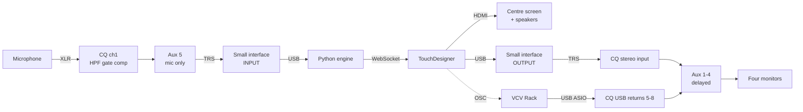

# theoracle — integration

How the physical installation goes together: the Allen & Heath CQ-12T, VCV Rack, the microphone,
the four monitors, and the screen.

For installing the software, see [`README.md`](README.md). For why the system is designed this way,
see [`TheOracleSystem.md`](TheOracleSystem.md).

---

## Contents

- [What has to happen](#what-has-to-happen)
- [The one constraint that shapes everything](#the-one-constraint-that-shapes-everything)
- [The signal map](#the-signal-map)
- [What you need](#what-you-need)
- [The CQ-12T patch sheet](#the-cq-12t-patch-sheet)
- [The microphone channel](#the-microphone-channel)
- [TouchDesigner audio](#touchdesigner-audio)
- [VCV Rack](#vcv-rack)
- [The engine's audio devices](#the-engines-audio-devices)
- [Delay alignment — the most important adjustment](#delay-alignment--the-most-important-adjustment)
- [Windows settings](#windows-settings)
- [Commissioning, in order](#commissioning-in-order)
- [Alternatives without the extra interface](#alternatives-without-the-extra-interface)
- [Troubleshooting](#troubleshooting)

---

## What has to happen

Four audio jobs, and they are not symmetrical:

| # | Job | From | To |
| --- | --- | --- | --- |
| 1 | The visitor's voice reaches the engine | Microphone | Python |
| 2 | The Oracle's voice is heard at the screen | TouchDesigner | Centre screen, over HDMI |
| 3 | The Oracle's voice is heard around the room | TouchDesigner | The four monitors |
| 4 | VCV Rack's music is heard around the room | VCV Rack | The four monitors, and **only** there |

Jobs 2 and 3 are the same sound in two places, which is the thing to get right. Job 4 never goes to
the screen.

---

## The one constraint that shapes everything

**On Windows, only one program can use the CQ-12T's USB audio at a time.** Allen & Heath require
their ASIO driver for multitrack streaming; ASIO allows a single application; and their WDM driver
cannot route to specific USB channels.

Three programs want that connection — Python for the microphone, TouchDesigner for the voice, VCV
Rack for the music. One of them can have it.

**VCV Rack gets it**, because it is the only one that needs four separate channels. The other two
reach the mixer as ordinary audio through a small second interface, which costs about €30 and
removes an entire category of problems: no shared driver, no virtual cables, no clock drift, no
program stealing the device from another at startup.

If you would rather not buy one, see
[Alternatives without the extra interface](#alternatives-without-the-extra-interface). They work,
with caveats worth reading before an installation runs for weeks.

---

## The signal map



In words:

- The **microphone** plugs into the mixer, gets its channel strip, and a mic-only mix leaves on
  Aux 5 into the small interface's input. Python hears that.
- The **Oracle's voice** is played by TouchDesigner to two places at once: the screen over HDMI,
  and the small interface's output into the mixer's stereo input, from where it is sent to all four
  monitors.
- **VCV Rack** owns the mixer's USB and sends four separate channels, one per monitor.
- **Aux 1–4 are delayed** so the monitors land together with the screen.

---

## What you need

| Item | Notes |
| --- | --- |
| Allen & Heath CQ-12T | 10 mic/line in, stereo line in, Main L/R XLR, 6 aux TRS out, 16×16 USB |
| Microphone + stand + windscreen | Visitors speak closely into it |
| 1 × XLR cable | Mic to the mixer |
| Small USB audio interface, 2-in/2-out | About €30. Class-compliant is fine |
| 2 × TRS cables | Aux 5 → interface in; interface out → mixer stereo in |
| 4 × powered monitors + cables | Around the room, from Aux 1–4 |
| Centre screen with speakers | HDMI from the laptop |
| USB-B cable | Mixer to laptop |

A 2-in/2-out interface does both jobs at once: its input carries the mic feed to Python, its output
carries the voice from TouchDesigner. Two separate cheap devices also work and remove any doubt
about two programs sharing one.

---

## The CQ-12T patch sheet

### Inputs

| Socket | Source | Channel | Sent to |
| --- | --- | --- | --- |
| Input 1 (XLR) | Microphone | Ch 1 | **Aux 5 only** |
| Stereo TRS input | Voice, from the small interface | Stereo channel | Aux 1, 2, 3, 4 |
| — (USB) | VCV Rack, 4 channels | Ch 5, 6, 7, 8 — set each channel's **source to USB** | One aux each: 5→Aux 1, 6→Aux 2, 7→Aux 3, 8→Aux 4 |

### Outputs

| Socket | Carries | Delay |
| --- | --- | --- |
| Aux 1–4 (TRS) | The four monitors: VCV's channel for that monitor, plus the voice | **Set — see below** |
| Aux 5 (TRS) | Microphone only, to the interface | 0 |
| Aux 6 (TRS) | Spare | — |
| Main L/R (XLR) | Spare — recording, or a house PA | — |

### The rules behind the table

- **Never send the microphone to Aux 1–4.** There is no reason to amplify the visitor, and it puts
  an open mic a few metres from four speakers.
- **Aux 5 contains channel 1 and nothing else.** That is what makes it impossible for the
  installation to transcribe its own voice, whatever the software does.
- **Each VCV channel goes to exactly one monitor.** That is the whole point of four discrete
  channels; summing them defeats it.
- **The voice goes to all four at equal level.** With the delay set, it arrives with the screen.

---

## The microphone channel

This is where most of your speech-recognition accuracy is won or lost. On channel 1:

| Setting | Start at | Why |
| --- | --- | --- |
| Gain | Set so normal speech peaks around −12 dBFS | Headroom without noise |
| High-pass filter | 80–120 Hz | Removes rumble and footsteps that Whisper tries to interpret |
| Gate | Threshold just above room tone at show level | **Stops Whisper inventing words out of silence** |
| Compressor | 3:1, a few dB of reduction | Evens out the visitor who leans in and the one who stands back |
| Phantom power | As the microphone requires | — |

**Set the gate with the monitors playing at show level, not in a silent room.** That is the
condition it has to work in. If the gate is set in silence it will open on the monitors later.

A windscreen matters more than it sounds: visitors speaking closely produce plosives, and a popped
P is a word the engine loses.

---

## TouchDesigner audio

TouchDesigner plays the voice **twice, simultaneously**, from the same file.

| Operator | Device | Goes to |
| --- | --- | --- |
| Audio File In CHOP → Audio Device Out CHOP | HDMI output | The centre screen's speakers |
| Same Audio File In CHOP → second Audio Device Out CHOP | The small interface | The mixer, then the four monitors |

One Audio File In CHOP feeding two Audio Device Out CHOPs keeps them sample-locked to each other;
the only offset is the one HDMI adds, and that is what the mixer delay compensates for.

Pick both devices explicitly by name. Never leave either on the Windows default — it moves the
first time anything is plugged in.

The analysis that drives the visuals comes off the Audio File In CHOP, so it is unaffected by any
of this.

---

## VCV Rack

**VCV owns the CQ's USB.** In VCV's audio module:

| Setting | Value |
| --- | --- |
| Driver | ASIO |
| Device | CQ-12T |
| Sample rate | 48 kHz — match the mixer |
| Block size | 256 or 512 to start |
| Module | Audio-16, using outputs 5–8 |

Outputs 5–8 arrive on the mixer's USB returns and are picked up by channels 5–8, one per monitor.
Use whichever USB return numbers the mixer shows; what matters is that each one lands on its own
channel and its own aux.

### Ducking

TouchDesigner sends the Oracle's state to VCV over OSC — use stoermelder's **OSC'elot** or Trowa's
**cvOSCcv**. The message worth wiring first is ducking: when the state becomes `speaking`, pull the
music down 3–6 dB through a VCA, and release it on `playback_finished`.

You said the soundscape is quiet enough that this may not be needed, and with a close-talked mic
that is probably right. Wire it anyway and set it to zero if you dislike it — it is one VCA and one
message now, and an awkward retrofit during install week.

---

## The engine's audio devices

In `config.yaml`:

```yaml
audio:
  input_device: "<fragment of the small interface's name>"   # the mic feed from Aux 5
  output_device: "<not used - TouchDesigner plays the audio>"
```

The engine only **records**. It writes WAV files and TouchDesigner plays them, so the engine has no
output device in the signal path at all.

Run `python scripts/check_env.py` to print every device name Windows can see, then paste a
distinctive fragment of the right one in. Run it again afterwards — it confirms the fragment matches
exactly one device, which is a common silent failure.

---

## Delay alignment — the most important adjustment

The voice comes out of the screen and out of the monitors. **HDMI audio runs 40–150 ms behind**,
because it is a separate clock domain with its own buffering. At that distance you do not hear one
sound from several places; you hear it twice. Intelligibility drops hard, and Finnish consonants go
first.

The CQ-12T has **output delay, up to 682 ms, per output socket** — `CONFIG` → `OUTPUTS`, select the
output. That is the fix: hold the monitors back until they land with the screen.

### Measuring it

1. Play a short, sharp sound through both paths — a clap sample, or the test WAV from Step 13.
2. Stand where a visitor stands. You will hear the monitors first, then the screen.
3. Set the delay on **Aux 1, 2, 3 and 4** to the same value and raise it until the two collapse into
   one sound. Start at 60 ms and work up in 10 ms steps; at the right value it stops sounding like
   an echo and starts sounding like one voice that is simply louder.
4. Record the value in `INTEGRATION.md` or on a label inside the rack. It is a property of that
   screen and that machine — if either changes, measure again.

If you want it exact rather than by ear, record the room on a phone and look at the two transients
in any audio editor; the gap between them is the delay to dial in.

### What the delay also does

It delays VCV's music by the same amount, since the whole monitor bus is delayed. That is what you
want: the music and the voice stay together on the monitors. The only thing left slightly early is
the screen's *picture* relative to the music, by that same 40–150 ms, which nobody perceives with
ambient sound.

---

## Windows settings

| Setting | Why |
| --- | --- |
| Display sleep **off**, screen saver **off** | Windows drops the HDMI audio endpoint when the display sleeps, and TouchDesigner then needs its output re-selected |
| USB selective suspend **off** | Stops Windows powering down the mixer or the interface mid-show |
| Sample rate 48 kHz everywhere | Mixer, interface and Windows device properties. Mismatches cause silent resampling and occasional clicks |
| Sounds → all system sounds **off** | A notification chime through four monitors during a visit |
| Power plan: High performance | Prevents clock throttling under load |

---

## Commissioning, in order

Do these in sequence. Each one leaves you with something proven, so a later failure has a small
number of possible causes.

1. **Cabling.** Everything physically connected, nothing powered on except the mixer.
2. **Microphone.** Gain, high-pass, gate, compressor on channel 1. Check the meter responds to
   speech and stays shut between sentences.
3. **Aux 5.** Confirm it carries the microphone and nothing else — speak, then play anything else
   into the mixer and confirm Aux 5 stays silent.
4. **Python's input.** `python scripts/check_env.py` lists devices; record a few seconds and play it
   back to confirm the mic feed arrives.
5. **VCV Rack.** ASIO to the CQ, four channels out, one per monitor. Confirm each monitor plays
   only its own channel.
6. **The voice path.** Play a test WAV from TouchDesigner to the small interface and confirm it
   appears on all four monitors.
7. **HDMI.** Same test WAV to the screen. Now you will hear the echo — this is expected.
8. **Delay.** Dial Aux 1–4 until the two collapse into one.
9. **Levels at show volume.** Balance voice against music from where a visitor stands, not from the
   mixer.
10. **Feedback check.** Monitors at show level, mic open, nobody speaking. Silence. If it rings,
    the mic is in a monitor mix — it should not be in any.
11. **Step 13 of the README.** The full round trip, sensor to spoken reply.

---

## Alternatives without the extra interface

Both work. Neither is what I would run unattended for weeks, and the reasons are worth knowing.

### VCV Rack as the audio hub, with virtual cables

Install VB-Audio Cable (two of them: A and B).

- VCV keeps the CQ over ASIO.
- VCV reads the microphone from the CQ's USB send and passes it out to **Cable A**; Python records
  from Cable A.
- TouchDesigner plays the voice to **Cable B**; VCV reads Cable B and mixes it into the four monitor
  sends.
- The delay can be done inside VCV instead of on the mixer.

No extra hardware, and VCV becomes a genuinely useful audio matrix. The catch is that VCV is then
running three audio devices on three different clocks. They drift, and drift produces occasional
clicks — rarely in an afternoon, reliably across a three-week exhibition. Soak-test it before
committing.

### The mixer's WDM driver alongside VCV's ASIO

Allen & Heath do not document whether their WDM and ASIO interfaces can be open at the same time. If
they can, Python could take the microphone from the CQ's WDM input while VCV holds ASIO, and no
second interface is needed for the mic.

It costs nothing to try: open VCV on ASIO, then run `check_env.py` and see whether the CQ appears as
a recording device that actually delivers audio. `check_env.py` opens each configured device rather
than only naming it, so `Error opening InputStream` there is the answer — something holds it
exclusively — and a clean `the driver accepts these settings` means the two drivers coexist on this
machine. If it works and survives a four-hour soak test, it works. If it is flaky, it will be flaky
in front of an audience.

#### Which host API Python takes

Windows publishes the CQ once per host API, so `CQ 1&2 (CQ12T)` appears three or four times in the
device list under identical names. The engine prefers **WASAPI**, and that is the right default
here: it is shared-mode, so it coexists with other applications, and its latency is low enough that
the microphone adds nothing you would notice.

**WDM-KS is the one to avoid.** It talks to the driver directly and takes the endpoint exclusively —
which is exactly the collision this whole section is about. If you ever pin a host API by hand in
`config.yaml`, pin WASAPI or MME, never WDM-KS.

ASIO does not appear in that list at all: the PortAudio build shipped in the `sounddevice` wheel is
compiled without it, because ASIO needs a licence from Steinberg. That is a convenience, not a
limitation — it means Python structurally cannot take the ASIO driver away from VCV Rack or
TouchDesigner, no matter how it is configured.

Neither alternative removes the need for the voice to reach the mixer, so the interface's *output*
half is still the simplest path there.

---

## Troubleshooting

| Symptom | Cause | Fix |
| --- | --- | --- |
| The voice echoes across the room | Monitors are not delayed to match HDMI | Set Aux 1–4 delay — see [Delay alignment](#delay-alignment--the-most-important-adjustment) |
| No voice from the screen after it went dark | Windows dropped the HDMI audio endpoint | Turn display sleep off; re-select the output in TouchDesigner |
| VCV Rack cannot open the CQ | Another program took it, or its driver is not ASIO | Close TouchDesigner's device if it was pointed there; confirm VCV's driver is ASIO |
| Clicks and dropouts in the music | Sample rate mismatch, or block size too small | 48 kHz everywhere; raise VCV's block size |
| Whisper transcribes words during silence | The gate is not set, or was set in a silent room | Set the gate with the monitors at show level |
| The Oracle responds to its own voice | The voice is reaching Aux 5 | Aux 5 must contain channel 1 only |
| Feedback ringing | The microphone is in a monitor mix | Remove it from Aux 1–4 entirely |
| One monitor plays everything | VCV channels summed, or channels not sourced from USB | Each VCV output to its own channel, each channel to its own aux |
| The engine hears nothing | Wrong input device, or Aux 5 not feeding the interface | `check_env.py` lists devices and verifies the config fragment |
| German replies sound quieter or slower than the others | `de_DE-thorsten-high` is a high-quality voice; the ten voices are not level-matched | Audition all ten as a set and adjust the stereo input level, not the voice |
