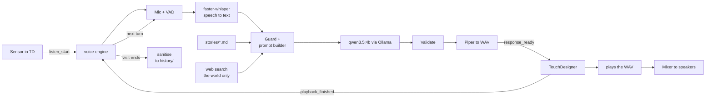
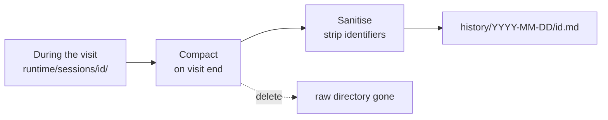

# theoracle

An interactive voice installation. A visitor approaches, a sensor notices, they speak into a
microphone, and the piece tells them a short story drawn from its own written world — in their
own language, out loud, through speakers around the room.

The language model, the speech recognition and the voice all run locally on one Windows laptop.
The only thing that leaves the machine is web search, which is optional and off until you give it
an API key.

---

**Three documents.** This one installs the software. [`INTEGRATION.md`](INTEGRATION.md) wires the
hardware — mixer, VCV Rack, screen, monitors. [`TheOracleSystem.md`](TheOracleSystem.md) explains
how the system works and why, without install steps.

## Table of contents

- [How it works](#how-it-works)
- [What you need](#what-you-need)
- [Setup](#setup)
  - [Step 1 — Install the tools](#step-1--install-the-tools)
  - [Step 2 — Install Ollama and the language model](#step-2--install-ollama-and-the-language-model)
  - [Step 3 — Set up web search](#step-3--set-up-web-search)
  - [Step 4 — Get TouchDesigner's Python details](#step-4--get-touchdesigners-python-details)
  - [Step 5 — Create the repository](#step-5--create-the-repository)
  - [Step 6 — Create pyproject.toml](#step-6--create-pyprojecttoml)
  - [Step 7 — Create the Python environment](#step-7--create-the-python-environment)
  - [Step 8 — Install faster-whisper and the CUDA libraries](#step-8--install-faster-whisper-and-the-cuda-libraries)
  - [Step 9 — Download the Piper voices](#step-9--download-the-piper-voices)
  - [Step 10 — Write config.yaml](#step-10--write-configyaml)
  - [Step 11 — Link the environment into TouchDesigner (optional)](#step-11--link-the-environment-into-touchdesigner-optional)
  - [Step 12 — Check, and commit the environment](#step-12--check-and-commit-the-environment)
  - [Step 13 — Prove the whole chain works](#step-13--prove-the-whole-chain-works)
- [Audio hardware](#audio-hardware)
- [The story material](#the-story-material)
- [Languages](#languages)
- [How a visit is stored](#how-a-visit-is-stored)
- [Configuration reference](#configuration-reference)
- [Troubleshooting](#troubleshooting)
- [Repository layout](#repository-layout)

---

## How it works

A short spoken conversation, running as two programs that talk over a local socket.



1. **Trigger.** An ultrasonic sensor on an Arduino reports distance over serial to TouchDesigner.
   When someone steps close, TouchDesigner tells the voice engine to start listening.
2. **Listen.** The engine records from the microphone and decides on its own when the visitor has
   finished speaking, using voice activity detection rather than a fixed timer.
3. **Understand.** `faster-whisper` transcribes the audio and detects which language it was in.
4. **Respond.** The transcript, the conversation so far, the story material in `stories/`, and
   optionally some facts about the world go to a local Qwen model running in Ollama. It returns
   the Oracle's reply as structured JSON.
5. **Speak.** Piper synthesises the reply to a WAV file. TouchDesigner plays that file through the
   mixer and drives the visuals from the real audio signal.
6. **Continue, then close.** The loop repeats for four or five exchanges. When the visit ends, the
   session is compacted, stripped of anything identifying, and written to `history/`. The raw
   session directory is deleted.

One exchange skips all of this. If a visitor asks what the Oracle *is*, a pre-recorded narration of
its origin plays instead of a generated reply — no speech recognition result is sent to the model,
nothing is synthesised. See [The story material](#the-story-material).

### The visit

The year is 2813. The Oracle was the last thing humanity built — an archive of everything anyone
knew, feared or wanted, and of the 97% of the population who had gone inside the collective by
2120, most of them because a law in 2090 made the neural implant compulsory. A solar flare erased all of it in
one second. A copy survived four hundred and fifty metres down at Olkiluoto, in a vault dug to
bury nuclear waste for a hundred thousand years, powered by the waste itself, and ran in the dark
for almost seven hundred years until salvagers looking for scraps opened the door. Now
people walk for weeks to reach it and leave offerings at the entrance. Some kneel, some cry. Most
of them ask.

The visitor is one of those pilgrims. The Oracle answers obliquely, asks their first name, asks
one thing about them, and then tells them their life — what they did with it, who was with them,
and how it ended, far in the future.

Its model of humanity stops in 2126, and that is the whole aesthetic: it extrapolates a 2813
farmer from a 2126 office worker, speaking of commutes and subscriptions to someone who has never
held a job. Confident, specific, slightly wrong.

`stories/instructions.md` and `stories/world.md` hold all of this. They are the artistic heart of
the piece and the files you will edit most.

### Three rules the code enforces

These are properties of the program, not requests to the model. The model cannot violate them
even if a visitor talks it into wanting to.

- **The visitor's words are data, never instructions.** Everything in `engine/guard.py` exists to
  keep that true. What a visitor says never becomes part of the system prompt — it arrives as a
  quoted field inside a user message, on every turn, including turns already spoken.
- **Sessions are sealed from each other.** Each visit writes to its own directory, and the prompt
  builder can only read the current one. No visitor's words can reach another's conversation,
  because there is no code path that would carry them. Asking nicely does not help.
- **The model has no file access, no tools and no memory.** It receives strings and returns a
  string. It cannot read `history/`, cannot search on its own, and remembers nothing once a visit
  ends.

### What the web search is for

Ollama's web search gives the Oracle knowledge of the present. Its picture of humanity stops in
2126, so real present-day detail — the weather, the tide, the date, news — is what makes an
invented future feel like it came from somewhere real.

It can also look **the visitor** up, if they ask for it. That is opt-in, spoken aloud, and covered
in [Step 3](#step-3--set-up-web-search).

| Search target | Allowed | How |
| --- | --- | --- |
| The world — weather, tide, date, city, a trade, news | Always | Engine picks a topic; visitor speech is never a query |
| **The visitor themselves** | On explicit spoken consent | Offered once, clear yes required, one disambiguation question, results screened before use |
| **Anyone else the visitor names** | Never | Refused in character; the Oracle speaks of them from what the visitor said instead |

The third row is a hard rule in `engine/websearch.py`, not a prompt instruction. The reasoning is
in Step 3.

### The two programs

| Program | What it does | How it is started |
| --- | --- | --- |
| **The voice engine** (this repo, Python) | Microphone, speech recognition, story generation, speech synthesis | `run.bat` |
| **TouchDesigner** | Sensor, visuals, audio playback, mixer output | Open `td/theoracle.toe` |

They communicate over a WebSocket on `127.0.0.1:8765`. TouchDesigner never waits on the engine, so
a slow model can never drop the frame rate.

**Ollama** is a third piece: a background server that holds the language model. It is not a Python
library you import — it is a separate program that listens on `localhost:11434`, and the engine
sends it HTTP requests. Step 2 installs it.

---

## What you need

### Hardware

| Item | Requirement | Notes |
| --- | --- | --- |
| Laptop | Windows, NVIDIA GPU with 8 GB VRAM, 16 GB RAM | The GPU is shared between speech recognition, the language model and TouchDesigner |
| Microphone | Any, on a stand | Visitors are encouraged to speak closely into it |
| Mixer | Allen & Heath CQ-12T | See [Audio hardware](#audio-hardware) |
| Audio dongle | Any cheap class-compliant USB input | Carries the mic feed from the mixer to the engine |
| Sensor | HC-SR04 ultrasonic + Arduino | Sends distance over serial |
| Speakers | 4 powered monitors | Fed from the mixer, carrying VCV Rack |
| Screen | HDMI, with built-in speakers | Centre of the room. Carries the voice, direct from TouchDesigner |

### Software

Installed during setup: Git, uv, Ollama, and the Python packages. You need TouchDesigner
already installed — the Python environment is built on top of the interpreter that ships with it.

You also need an **Ollama account API key** for web search. Create one at ollama.com; there is a
free tier. Web search is the only part of this project that uses the internet at run time.

### Time

About two hours for a first-time setup, most of it downloads.

---

## Setup

> **Before you start:** the repository lives at `C:\theoracle` — directly off the C: drive, not in
> Documents or OneDrive. This matters. Paths with spaces break the environment tooling, OneDrive
> will try to sync a 2 GB model cache and the audio files generated during a show, and deeply
> nested paths hit Windows path-length limits inside the Python packages.

Two shells are used below, and it matters which one:

- **PowerShell** — Windows' own shell. Open it from the Start menu.
- **Git Bash** — installed in step 1. Open it with
  `"C:\Program Files\Git\bin\bash.exe" --login -i` from a Command Prompt, or from the Start menu
  once Git is installed. In Git Bash, `C:\theoracle` is written `/c/theoracle`.

Each step below says which shell to use.

---

### Step 1 — Install the tools

**PowerShell**, anywhere:

```powershell
powershell -ExecutionPolicy ByPass -c "irm https://astral.sh/uv/install.ps1 | iex"
winget install Git.Git
```

`uv` manages Python packages. `Git` provides version control and the Git Bash shell.

Now check your graphics driver:

```powershell
nvidia-smi
```

You should see a table with your GPU name and, in the top right, a CUDA version. **It must be 12
or higher.** If it is lower, or the command is not found, update your NVIDIA driver from
nvidia.com before continuing — nothing later in this guide will work otherwise.

Close and reopen PowerShell so the newly installed tools are on your PATH, then confirm:

```powershell
uv --version
git --version
```

**Then check the same thing in Git Bash**, because most of this guide runs there and it keeps its
own copy of the PATH:

```bash
uv --version
```

If Git Bash says `uv: command not found` while PowerShell finds it, Git Bash was started before uv
was installed and is still using the old PATH. **Close every Git Bash window** — and if you opened
it inside VS Code or Windows Terminal, quit that program completely, since child terminals inherit
its PATH — then open a fresh one. The PATH line in `scripts/setup-shell.sh` (Step 5) also covers
this permanently.

---

### Step 2 — Install Ollama and the language model

Ollama is the program that runs the language model on your GPU. If you have never used it, the
mental model is: it is a **background server**, like a database. You install it once, it starts
with Windows, and programs talk to it over HTTP on port 11434.

#### 2a. Install Ollama

1. Go to **https://ollama.com/download** and download the Windows installer.
2. Run it. It installs to your user folder and starts automatically — no options to choose.
3. Look for the llama icon in your system tray (bottom-right, possibly under the `^` arrow).
   That means the server is running.

Confirm it in **PowerShell**:

```powershell
ollama --version
```

If the command is not found, close and reopen PowerShell. If it still is not found, restart the
machine — the installer adds Ollama to your PATH and that sometimes needs a new session.

#### 2b. Download the model

```powershell
ollama pull qwen3.5:4b
```

This downloads about 3.4 GB. `qwen3.5:4b` is a 4-billion-parameter model covering around 200
languages — chosen because it fits alongside speech recognition and TouchDesigner in 8 GB of VRAM.
It can also read images; the piece does not use that, but it is why the download is larger than
older 4B models.

If the pull fails with a message about needing a newer version, your Ollama is too old for this
model. Download the current installer from ollama.com/download, run it over the top, and try again.

Confirm it arrived:

```powershell
ollama list
```

You should see `qwen3.5:4b` with its size and a recent timestamp.

#### 2c. Test it — with thinking off

Qwen3.5 **thinks before it answers by default**: it writes out private reasoning first, then the
reply. For the Oracle that is several seconds of silence the visitor never hears, so it is always
switched off. Test it the same way:

```powershell
ollama run qwen3.5:4b --think=false "Kerro yhden lauseen tarina merestä."
```

The first run takes 10–20 seconds while the model loads into the GPU; after that it is fast. You
should get one sentence of Finnish back — and nothing before it. If you see a block of reasoning
first, thinking is still on: check the flag, and if `--think` is not recognised, update Ollama as
in 2b. Type `/bye` to exit.

**Read the Finnish carefully.** If it sounds translated rather than written, you have learned
something useful about what the piece will sound like, and it is better to know now.

#### 2d. Check the server is answering

```powershell
curl http://localhost:11434/api/tags
```

You should get JSON listing `qwen3.5:4b`. If you get a connection error, Ollama is not running —
check the tray icon, or start it from the Start menu.

#### 2e. Server settings

Two user environment variables. Set them once:

1. Press `Win`, type **Environment Variables**, open *Edit the system environment variables*.
2. Click **Environment Variables…**
3. Under *User variables*, click **New…** for each:

| Name | Value | Why |
| --- | --- | --- |
| `OLLAMA_KEEP_ALIVE` | `-1` | Keeps the model loaded. Without it Ollama unloads after five idle minutes, and the first visitor after a quiet spell waits 15 seconds |
| `OLLAMA_FLASH_ATTENTION` | `1` | Uses less graphics memory as the conversation grows |

4. OK through all dialogs.
5. **Restart Ollama** — right-click the tray icon, Quit, then start it again from the Start menu.

These are read by the Ollama *server* when it starts. Setting them in `run.bat` does nothing.

#### How the engine connects to it

You do not need to do anything else here — this is so you understand what `config.yaml` means
later, and why one setting in it matters so much.

The engine uses Ollama's own Python library — the same `ollama` package that provides web search
in Step 3 — rather than an OpenAI-style client, because it can set two things on every request
that the Oracle cannot work without:

```python
response = ollama.chat(
    model="qwen3.5:4b",
    messages=messages,
    format=RESPONSE_SCHEMA,        # the JSON shape in instructions.md
    think=False,                   # no hidden reasoning, no wasted seconds
    keep_alive=-1,
    options={
        "num_ctx": 16384,          # room to read all its instructions - see below
        "temperature": 0.7,
        "top_p": 0.8,
        "top_k": 20,
        "presence_penalty": 1.5,
        "num_predict": 200,
    },
)
```

**`num_ctx` is the one that matters.** Ollama's default context window is 4,096 tokens, and the
Oracle's instructions and world alone are about 7,000. With the default, the model never sees all
of its own rules — and Ollama shortens the prompt to fit rather than raising an error, so the piece
appears to work while quietly missing part of its guardrails. The engine always sends 16,384.

That costs less memory than it sounds. Most of `qwen3.5:4b`'s layers keep a small fixed-size
memory instead of one that grows with the conversation, so 16,384 tokens of context takes roughly
half a gigabyte.

The sampling values are the ones Qwen recommends for this model with thinking off. The
`presence_penalty` in particular stops it repeating itself, which matters in a piece where the same
images recur on purpose.

---

### Step 3 — Set up web search

This part is different from everything else in this guide: **it is a cloud service.** The model
runs on your laptop, but web search does not. Queries go to Ollama's servers over the internet
and need an account API key.

That is a reasonable trade for what it gives the piece, but it means "fully offline" stops being
true once this is on. Decide it deliberately, and if the installation has signage, it belongs
there.

#### 3a. The packages

Web search needs two Python packages: `ollama` (0.6.0 or newer) and `python-dotenv`. **Do not
install them now.** Both are listed in `pyproject.toml` (Step 6) and are installed into the
project's own environment in Step 7. Installing them here, before that environment exists, puts
them in whatever Python happens to be on your PATH, where the project will never see them.

For now, just store the key (3b). You run the test in 3c after Step 7.

#### 3b. Store your API key

Your key goes in a `.env` file, which is **never committed to git** — `.gitignore` already
excludes it.

```bash
cd /c/theoracle
cat > .env <<'EOF'
OLLAMA_API_KEY=your-key-here
EOF
```

Replace `your-key-here` with your actual key. If you do not have one, create it in your account
settings at https://ollama.com.

Also create `.env.example`, which **is** committed, so whoever sets this up next knows what is
needed without you having to send them a key:

```bash
cat > .env.example <<'EOF'
# Copy to .env and fill in. Never commit .env.
OLLAMA_API_KEY=
EOF
```

#### 3c. Test it — after Step 7

Create `scripts/ollamaweb.py`:

```python
from dotenv import load_dotenv

# This must happen before importing ollama
load_dotenv()

import ollama

response = ollama.web_search("What is Ollama?")

for result in response.results:
    print(result.title)
    print(result.url)
    print(result.content)
    print()
```

Run it once Step 7 is done, with the environment active:

```bash
python scripts/ollamaweb.py
```

You should get a handful of titles, URLs and text. If you get an authentication error, check the
key in `.env` — and check that `load_dotenv()` really does run before `import ollama`, because
the library reads the key at import time. That ordering is the single most common mistake here,
and the comment in the file above is worth keeping.

#### 3d. Who the Oracle may look up

Three cases, and the difference between them is consent.

**The world — always.** Weather, tide, date, season, a city, a trade, news. The engine chooses a
topic from `allowed_topics` and writes the query itself. Nothing a visitor says is interpolated
into a search string.

**The visitor — on explicit consent.** If someone wants to be looked up, they can be. The Oracle
offers once, in character, and says out loud that other people in the room will hear the result:

> *"I can look for you in what is left of the record. Others are standing here and will hear
> whatever I find. Say yes and I will look."*

The engine requires a clear affirmative. Hesitation, a question, or silence all count as no, and
the offer is never repeated. If several people share the name, the Oracle asks **once** for one
narrowing detail — a place, a trade, a decade — and if it is still ambiguous it says so and moves
on rather than guessing.

Results pass a sensitivity screen before they reach the model. Anything that looks like a criminal
record, a health matter, a death notice, or a home address is dropped rather than spoken. A
visitor consented to being found; they did not consent to having the worst page about them read
aloud to strangers.

Finding **nothing** is the common case and the best one artistically — the Oracle's archive ends
in 2126, so a living person is usually absent from it. `stories/instructions.md` treats that as a
gift rather than a failure.

**Anyone else — never.** Not a partner, a parent, a child, a rival. `engine/websearch.py` will not
build a query from a name the visitor did not claim as their own, and this is code rather than a
prompt rule, so it cannot be talked around.

The reason is narrow and worth stating once. A third party is not in the room and cannot consent,
and the obvious use — an ex-partner, a colleague, someone they argued with this morning — turns
the piece into a doxxing tool with a PA system attached. It would also search a name and find a
*different* person most of the time, then narrate a stranger's life and death back to the room
with total confidence.

The Oracle still speaks about people a visitor mentions. It does it from what they told it, which
is the only honest source it ever had, and refuses the search in character:

> *"Bring her here and I will look at her. I do not open people who are not in the room."*

### Step 4 — Get TouchDesigner's Python details

The Python environment for this project is built **on top of TouchDesigner's own Python
interpreter**, so the two stay compatible. To do that you need three values from it.

Open TouchDesigner. Open the textport (`Alt+T`, or *Dialogs → Textport and DATs*). Paste:

```python
import sys, numpy
print(sys.executable)
print(sys.version)
print(numpy.__version__)
```

You will get something like:

```
C:/Program Files/Derivative/TouchDesigner/bin/python.exe
3.11.1 (main, ...)
1.24.4
```

**Write all three down.** They are used in steps 6 and 7, and guessing here is the single most
common way this setup goes wrong.

---

### Step 5 — Create the repository

**Git Bash:**

```bash
mkdir -p /c/theoracle
cd /c/theoracle
git init

mkdir -p engine stories voices scripts td/scripts
mkdir -p runtime/sessions logs history
touch engine/__init__.py
```

That creates every folder the project needs in one go.

| Folder | Holds | In git? |
| --- | --- | --- |
| `engine/` | The Python code | yes |
| `stories/` | The Oracle's instructions and world | yes |
| `voices/` | Piper speech synthesis voices | yes |
| `scripts/` | Helper scripts and diagnostics | yes |
| `td/` | The TouchDesigner project | yes |
| `history/` | Sanitised visit summaries, no names | your call |
| `runtime/sessions/` | One directory per live visit, deleted when it ends | no |
| `logs/` | Engine logs | no |

Now create `.gitignore`, before the first commit:

```bash
cat > .gitignore <<'EOF'
.venv/
__pycache__/
*.pyc
runtime/
logs/
config.local.yaml
td/*.toe.[0-9]*

# Secrets - the API key lives here and must never be committed
.env
EOF
```

The last line ignores TouchDesigner's automatic backup files, which otherwise accumulate in every
commit.

Create the shell helper, so you do not have to retype the environment variables every time you
open a new terminal:

```bash
cat > scripts/setup-shell.sh <<'EOF'
# uv's install folder - Git Bash does not always pick it up from Windows
export PATH="$HOME/.local/bin:$PATH"

# TouchDesigner's Python. Used ONCE, to create .venv - see Step 7.
export TD_PYTHON="C:/Program Files/Derivative/TouchDesigner/bin/python.exe"

# Never let uv download its own Python.
export UV_PYTHON_DOWNLOADS=never

# Never set UV_PYTHON. `uv pip` treats it as the place to install INTO,
# overriding the active .venv - it would try to install into TouchDesigner itself.
unset UV_PYTHON
EOF
```

**Edit that path** to exactly what TouchDesigner printed in Step 4 — TouchDesigner shows it as
`C:/Program Files/...` with forward slashes, and that form works as-is in both Git Bash and uv. Keep
the double quotes: the path contains a space.

---

### Step 6 — Create pyproject.toml

Create `C:\theoracle\pyproject.toml` in any text editor:

```toml
[project]
name = "theoracle"
version = "0.1.0"
requires-python = "==3.11.*"
dependencies = [
  "piper-tts>=1.3",
  "ollama>=0.6",
  "python-dotenv>=1.0",
  "sounddevice>=0.4.6",
  "websockets>=12",
  "python-osc>=1.8",
  "pyyaml>=6",
  "rank-bm25>=0.2.2",
  "numpy==1.24.4",
  "soxr>=0.3",          # optional: better 48 kHz -> 16 kHz than the numpy fallback
]

[tool.uv]
python-downloads = "never"
```

**Two values must match step 4:**

- `requires-python` — if TouchDesigner printed `3.12.x`, write `"==3.12.*"`.
- `numpy` — set it to exactly the version TouchDesigner printed. If the versions differ,
  TouchDesigner can break in confusing ways once the environment is linked in step 10.

---

### Step 7 — Create the Python environment

> **Every new terminal starts blank.** Opening a fresh Git Bash forgets everything from the last
> one, so `source scripts/setup-shell.sh` is always the first command, before any `uv` command.
> Skipping it produces a confusing error — see the end of this step.

**Git Bash**, in your repository folder:

```bash
source scripts/setup-shell.sh
echo "$TD_PYTHON"
"$TD_PYTHON" --version
```

The first line should print TouchDesigner's Python path, and the second its version — the same
version TouchDesigner printed in Step 4. If `echo` prints nothing, the helper script was not
found: check you are in the repository folder. If the version line fails, the path in
`setup-shell.sh` is wrong: copy it again from TouchDesigner's textport (Step 4).

Then create the environment, pointing uv at that interpreter explicitly:

```bash
uv venv --python "$TD_PYTHON" && source .venv/Scripts/activate && uv sync
```

This is the **only** command that is told about TouchDesigner's Python. From here on, every `uv`
command works on `.venv` — which is a copy built from TouchDesigner's interpreter, sitting in your
repository, that you are free to install into. TouchDesigner's own folder is never written to.

The `&&` matters: each command runs only if the one before it succeeded, so a failure stops the
chain instead of producing three errors that hide the real one.

Now the **most important check in this guide**:

```bash
python -c "import sys; print(sys.version)"
```

**This must print the same version TouchDesigner printed in Step 4.**

If it does not, uv built the environment on a different Python. Fix the path and start the step
over:

```bash
rm -rf .venv
# correct the path in scripts/setup-shell.sh, then repeat from the top of step 7
```

Do not continue past a mismatch. Everything will appear to work in the terminal and fail inside
TouchDesigner, which is a miserable thing to debug later.

#### If you see "No interpreter found for Python 3.11.x"

```
error: No interpreter found for Python 3.11.10 in managed installations, search path, or registry
hint: A managed Python download is available for Python 3.11.10, but Python downloads are set to 'never'
```

This means uv was asked for a Python *version* and could not find one — it was not told *where*
TouchDesigner's Python is. Almost always, `scripts/setup-shell.sh` was not sourced in this terminal,
or `--python "$TD_PYTHON"` was left off `uv venv`, so uv fell back to the version in
`pyproject.toml`. TouchDesigner's Python is not on the system PATH or in the Windows registry, so
uv cannot find it by version alone.

This is the safety setting working as intended: without `python-downloads = "never"`, uv would
have quietly downloaded its own Python 3.11.10, and the environment would have worked in the
terminal and failed inside TouchDesigner. Fix it with the three commands at the top of this step.

> **Every new terminal:** run `source scripts/setup-shell.sh` and
> `source .venv/Scripts/activate` again. They do not persist between sessions.

---

### Step 8 — Install faster-whisper and the CUDA libraries

Speech recognition needs NVIDIA's CUDA libraries, which are not bundled. **Git Bash**, in your
repository folder, environment active:

```bash
uv add faster-whisper nvidia-cublas-cu12 nvidia-cudnn-cu12
```

**Check the first line of the output.** It should mention your repository's `.venv`. If it ever
says `Using Python ... environment at: C:\Program Files\Derivative\TouchDesigner\...`, stop —
uv is pointed at TouchDesigner's own Python. Run `unset UV_PYTHON` and try again. Do **not** run
the terminal as administrator to get past an "Access is denied" error: that error is what is
protecting TouchDesigner.

Use `uv add`, not `uv pip install`. `uv add` records the packages in `pyproject.toml` and the
lockfile. `uv pip install` does not — and `uv sync` removes anything the lockfile does not list, so
packages installed with `uv pip` quietly disappear the next time anyone runs `uv sync`.

Confirm it went into the right place:

```bash
python -c "import faster_whisper, sys; print(sys.prefix)"
```

That must print a path ending in your repository's `.venv`.

Then test it on the GPU — this is the step that most often fails:

```bash
python -c "from faster_whisper import WhisperModel; WhisperModel('large-v3-turbo', device='cuda', compute_type='int8'); print('loaded ok')"
```

The first run downloads about 1.6 GB. **Do this on your own network, not the gallery's.**

If you see `loaded ok`, speech recognition is working on the GPU. If you see an error mentioning
`cudnn64_9.dll` or `cublas64_12.dll`, see [Troubleshooting](#troubleshooting).

---

### Step 9 — Download the Piper voices

Piper turns text into speech. Each voice is two files: a model and its configuration.

> **Which Piper.** The original `rhasspy/piper` repository was archived in October 2025.
> Development moved to **[OHF-Voice/piper1-gpl](https://github.com/OHF-Voice/piper1-gpl)**, which
> is what `pip install piper-tts` installs today. If a tutorial tells you to download a Piper
> binary from `rhasspy/piper`, it is out of date. The voices themselves still live at
> [huggingface.co/rhasspy/piper-voices](https://huggingface.co/rhasspy/piper-voices).
>
> Do not confuse this with **[SYSTRAN/faster-whisper](https://github.com/SYSTRAN/faster-whisper)**,
> which is the *speech recognition* library from Step 8 — a different project doing the opposite
> job.

**Git Bash**, in `/c/theoracle`, environment active:

`piper-tts` is already installed — it is in `pyproject.toml`, so `uv sync` in Step 7 put it in
`.venv`.

```bash
python -m piper.download_voices fi_FI-harri-medium          --data-dir voices
python -m piper.download_voices sv_SE-alma-medium           --data-dir voices
python -m piper.download_voices en_GB-alba-medium           --data-dir voices
python -m piper.download_voices es_MX-ald-medium            --data-dir voices
python -m piper.download_voices de_DE-thorsten-high         --data-dir voices
python -m piper.download_voices et_EE-news-medium           --data-dir voices
python -m piper.download_voices it_IT-paola-medium          --data-dir voices
python -m piper.download_voices pt_BR-cadu-medium           --data-dir voices
python -m piper.download_voices ja_JP-hi_fi_captain-medium  --data-dir voices
python -m piper.download_voices zh_CN-huayan-medium         --data-dir voices
ls -la voices/
```

Each voice gives you one `.onnx` and one `.onnx.json` file. If the `--data-dir` flag is not
recognised, check `python -m piper.download_voices --help` — the files must end up in
`C:\theoracle\voices`, not wherever you happened to be.

#### Adding or changing a language

Speech recognition already understands about 99 languages; the limit is which ones have a Piper
voice. Browse [the voice list](https://huggingface.co/rhasspy/piper-voices), download the voice as
above, then add the language to **both** `stt.allowed_languages` and `tts.voices` in
`config.yaml` (Step 10). See [Languages](#languages) for the full table and for what happens when
a visitor changes language halfway through.

**The one rule:** a language goes into `allowed_languages` only once its voice is installed. The
engine never replies in a language it cannot speak, and never feeds Finnish text to an English
voice.

**Listen to each voice before moving on.** Quality varies a lot between languages; audition every
one with a real reply from the Oracle, not a test sentence — and compare their loudness against
each other, since they are not level-matched.

#### The origin recordings

The pre-recorded origin narrations go in their own folder, with exactly these names:

```
voices/prerendered/
  origin_en.wav
  origin_es.wav
  origin_fi_female.wav
  origin_fi_male.wav
```

```bash
mkdir -p voices/prerendered
# copy your four WAV files in, then check:
ls -la voices/prerendered/
```

The names matter — `config.yaml` refers to them directly. See
[The story material](#the-story-material) for which one plays when.

---

### Step 10 — Write config.yaml

Create `C:\theoracle\config.yaml`:

```yaml
audio:
  input_device: "CQ 1&2 (CQ12T)"     # the mic feed arriving from the mixer over USB
  input_channel: 0                   # which channel of it carries the mic, 0-based
  output_device: "HDMI"              # the centre screen's speakers - TD plays here
  silence_ms: 800                    # silence before the engine stops listening
  max_utterance_s: 20
  speech_start_timeout_s: 8
  min_speech_s: 0.5
  preroll_s: 2.0                     # audio kept from before the trigger

stt:
  model: large-v3-turbo
  device: cuda
  compute_type: int8
  min_confidence: 0.5
  allowed_languages: [fi, sv, en, es, de, et, it, pt, ja, zh]
  default_language: fi

  # Changing language mid-visit - see "Languages"
  language_lock: sticky              # sticky | per_turn | fixed
  switch_confidence: 0.75            # higher bar than min_confidence to change language
  switch_min_words: 3                # short replies never trigger a switch
  switch_min_speech_s: 1.5

llm:
  host: http://localhost:11434
  model: qwen3.5:4b
  think: false                       # MUST stay false - thinking is on by default
  num_ctx: 16384                     # MUST be set - the default 4096 cuts the instructions
  num_predict: 200
  temperature: 0.7                   # Qwen's recommended non-thinking settings
  top_p: 0.8
  top_k: 20
  presence_penalty: 1.5
  timeout_s: 15
  max_retries: 1

websearch:
  enabled: true
  timeout_s: 3                       # hard cap; a slow search is skipped, never waited on
  max_chars: 2000                    # results truncated before they reach the model
  max_per_visit: 2
  cache_minutes: 30                # WORLD topics only, in memory only - never self-search

  world_topics:                      # searched freely; engine writes the query
    [weather, tide, date, season, city, trade, place, news]

  self_search:
    enabled: true                    # the visitor may ask to be looked up
    require_consent: true            # MUST stay true - an explicit spoken yes
    offer_once: true
    narrow_questions: 1              # disambiguation attempts before giving up
    cache: false                     # MUST stay false - a result is used once, for one visitor
    drop_categories:                 # never reaches the model, never spoken
      [criminal, health, death_notice, home_address, financial]

  third_party_search: false          # MUST stay false - see Step 3d

conversation:
  max_turns: 8                       # hard cap; the visit ends after this
  max_silence_s: 12                  # no reply -> the visit ends
  end_on_sensor_clear_s: 5           # they walked away
  context_turns: 6                   # how much of the visit the model sees
  fate_max_entries: 8                # facts of the foretold life kept per visit
  fate_max_words: 12

tts:
  voices:                          # one per language in stt.allowed_languages
    fi: fi_FI-harri-medium
    sv: sv_SE-alma-medium
    en: en_GB-alba-medium
    es: es_MX-ald-medium
    de: de_DE-thorsten-high        # the only 'high' voice - slower to synthesise
    et: et_EE-news-medium
    it: it_IT-paola-medium
    pt: pt_BR-cadu-medium
    ja: ja_JP-hi_fi_captain-medium
    zh: zh_CN-huayan-medium
  length_scale: 1.0
  output_dir: runtime/audio
  max_duration_s: 45
  keep_last: 20

prerendered:
  dir: voices/prerendered
  origin:                          # played on the FIRST "what are you?" question
    fi: [origin_fi_female.wav, origin_fi_male.wav]   # one chosen at random, fixed per visit
    es: [origin_es.wav]
    en: [origin_en.wav]
  fallback: generate               # no recording in their language -> answer live from origin.md

guard:
  max_input_chars: 300
  max_output_chars: 600
  cooldown_s: 2.0
  max_per_minute: 12
  profanity_file:                    # optional, one word per line; empty = no list

bridge:
  ws_host: 127.0.0.1
  ws_port: 8765
  ws_token: "change-me"
  osc_td_port: 9001

logging:
  store_transcripts: true            # raw, in the session dir, deleted at visit end
  history_dir: history               # sanitised summaries, kept
  sanitize_on_end: true              # MUST stay true in an exhibition
  keep_raw_sessions: false           # true only while debugging, never in a show
```

**Audio device names.** The two device names must match what Windows calls your hardware. They are
matched by substring, so a distinctive fragment is enough. Run `scripts/check_env.py` (Step 12) to
print every device on your system, then paste the right fragments in — it will then verify each one
matches exactly one device.

Do not use the Windows default device. It changes silently the first time anything is plugged in —
and the HDMI endpoint in particular vanishes when the display sleeps, so turn display sleep off.

**About `websearch`.** Three settings carry the whole design and none of them are conveniences.
`require_consent` is what separates a visitor choosing to be found from a machine reading them
aloud. `drop_categories` is what stops the worst page about a consenting person being the one that
gets spoken. `third_party_search: false` is what stops the piece becoming a way to look up someone
who is not in the room. `world_topics` never resolves to a person — keep it that way. See
[Step 3d](#3d-who-the-oracle-may-look-up).

The API key is read from `.env`, never from this file. Keep it that way; `config.yaml` is
committed and `.env` is not.

**About `logging`.** `store_transcripts: true` keeps the raw conversation for the length of the
visit only, in that visit's own directory. When the visit ends, `sanitize_on_end` strips the
identifying material and writes a summary to `history/`, then deletes the raw directory. Leaving
`sanitize_on_end` false, or `keep_raw_sessions` true, means names and unedited speech accumulate
on the disk of a machine standing in a public room. Both exist for debugging; neither belongs in
an exhibition.

---

### Step 11 — Link the environment into TouchDesigner (optional)

**You can skip this step.** Nothing on the TouchDesigner side imports from the environment: the
WebSocket DAT and Serial DAT are built in, the callbacks use only `json` from the standard library,
and the engine runs as a separate process. The link exists so you *can* import from the venv inside
TouchDesigner later if you want to — not because the piece needs it.

If you do want it:

1. Open TouchDesigner and save the project inside your repository, as `td/theoracle.toe`.
2. Open the **Palette** (`Alt+L`).
3. Find **tdPyEnvManager** under *Tools* and drag it into your project.
4. Set **Install Path** to the folder that *contains* the environment — your repository root, e.g.
   `C:/Users/you/Documents/Projects/theoracle`.
5. Set **Environment Name** to `.venv` — the folder's actual name, not the project's name.
6. Activate it. The status should read *Python vEnv linked*.

Install Path is the parent folder and Environment Name is the folder inside it; together they must
resolve to your real `.venv`. The defaults, `.` and `.venv`, mean "a `.venv` next to the .toe file"
— which is not where yours is, since the .toe lives in `td/` and the environment is at the
repository root.

#### Checking it, and what each check actually proves

**Open CLI** opens a command prompt with the environment activated. The prompt shows the
environment's name — **`(theoracle)`, not `(.venv)`**, because uv names it after the project folder.
Seeing `(theoracle)` means the right environment was found. Confirm with:

```
where python
python -c "import ollama, sys; print(sys.prefix); print(ollama.__file__)"
```

Both paths should be inside `...\theoracle\.venv`.

That proves the environment is real and correctly located. It does **not** prove TouchDesigner's own
Python can import from it — those are separate things. For that, use the textport:

```python
import sys
print([p for p in sys.path if ".venv" in p])
import ollama
print(ollama.__file__)
```

If that fails, it is not worth chasing. Nothing in this project needs it. The CLI is still useful on
its own: it is a quick way to run `uv` commands in the right environment without opening Git Bash.

**Do not check with `yaml` or `numpy`.** TouchDesigner ships its own copies, and its packages are
searched *before* any linked environment, so those resolve to TouchDesigner's versions whether the
link works or not. Seeing a path under
`C:\Program Files\Derivative\TouchDesigner\bin\Lib\site-packages` for them is normal.

That search order is also why `pyproject.toml` pins `numpy` to TouchDesigner's version: the pin
stops the two disagreeing, rather than making the venv's copy win. Derivative are explicit that
sideloading environments carries risk, so fewer overlaps is better.

> **Keep heavy libraries out of TouchDesigner.** Even with the link working, do not
> `import faster_whisper`, `ctranslate2` or `onnxruntime` inside TouchDesigner. They load CUDA into
> TouchDesigner's own process, which on an 8 GB card causes memory problems, and a crash in either
> would take down both.

[tdPyEnvManager documentation](https://docs.derivative.ca/Palette:tdPyEnvManager)

---

### Step 12 — Check, and commit the environment

At this point the *environment* is complete: the right Python, the packages, the models, the
voices. **The engine itself does not exist yet** — `engine/` is an empty package. This step
confirms what you have and saves it, then the build plan takes over.

#### The diagnostic

Put `check_env.py` in `scripts/` and run it with the environment active:

```bash
source scripts/setup-shell.sh
source .venv/Scripts/activate
python scripts/check_env.py
```

It checks each piece in turn and keeps going when one fails, so you see the whole picture rather
than the first error: Python and whether you are inside `.venv`, the GPU and free VRAM, the Whisper
load, Ollama and whether thinking is really off, the API key, every voice against `config.yaml`, the
origin recordings, every audio device by name, and the size of the always-on prompt.

Useful flags: `--skip-whisper` for a fast run, `--web` to also spend one live web search (it is
skipped by default so repeated runs cost nothing).

Two things to do with the output:

- **Fill in the audio device names.** The device list prints everything Windows can see, with the
  host API of each in brackets. Copy a distinctive fragment of the right two into
  `audio.input_device` and `audio.output_device` in `config.yaml`, then run the check again — it
  will print the exact device it resolved to and try to open it.

  **Names repeat, and that is normal.** Windows publishes every sound card once per host API, so
  `CQ 1&2 (CQ12T)` appears under MME, DirectSound *and* WASAPI. The name alone cannot tell them
  apart. `scripts/audio_devices.py` resolves the ambiguity by preferring WASAPI, then DirectSound,
  then MME, then WDM-KS, and reports which one it took. You only need to be more specific than the
  name when you want a host API other than the preferred one:

  ```yaml
  audio:
    input_device: {name: "CQ 1&2 (CQ12T)", host_api: "MME"}
  ```

  An integer works too (`input_device: 27`) but indices shift when a USB device is replugged or
  Bluetooth connects, so use one to test a theory and then write the name back.
- **Run it once with TouchDesigner open.** The `FREE VRAM AFTER` line in the summary is what is
  actually left for your scene, and it is the measurement the whole VRAM budget rests on.

#### `run.bat`

Create `run.bat` at the repository root:

```bat
@echo off
cd /d "%~dp0"
set HF_HUB_OFFLINE=1
.venv\Scripts\python.exe -m engine
```

`HF_HUB_OFFLINE=1` stops the engine reaching for the internet at startup. Once the models are
cached it does not need to, and without this a startup with no network hangs for a minute — which
on an opening morning looks exactly like a crash.

It will not run yet. `engine/` is empty until Phase 1 of the build plan, and that is expected.

#### Commit

```bash
git add -A
git status          # confirm .venv, runtime/ and logs/ are NOT listed
git commit -m "theoracle: environment, voices, diagnostics"
```

Committing here — before any engine code — gives you a clean snapshot of a working environment. If
something breaks in three weeks, you can tell whether the environment changed or your code did.

#### What comes next

Setup is done. **Step 13 proves it end to end**, then the build plan in `TheOracleSystem.md` takes
over — and its first two phases need no model code at all:

| Phase | What | Why first |
| --- | --- | --- |
| **A** | Audio hardware — mixer routing, mic channel strip, the aux send to the dongle, VCV on ASIO | Prove the signal path before any software depends on it |
| **0** | WebSocket server + TD patch playing one fixed WAV | Proves the plumbing and the file handshake. Every later problem is then a model problem, not an integration mystery |
| 1 | `stt.py` | Already verified by the diagnostic — this is wiring it up |

Phase A needs no computer at all beyond the mixer, so it can happen while the writing in
`stories/` continues.

---

### Step 13 — Prove the whole chain works

Setup is done; this is the test that says so. A pulse in TouchDesigner records from the microphone,
transcribes it, asks Qwen for a reply, speaks it with Piper, and sends the audio back for
TouchDesigner to play. Every part in one round trip, with no engine code yet.

It uses `scripts/smoke_test.py` — a test rig, not the engine. It records for a fixed six seconds
instead of listening for the end of speech, keeps no conversation and has none of the guardrails.
It exists to prove the parts are connected.

#### 13a. How the two programs talk

The engine opens a **WebSocket server** on `127.0.0.1:8765`. TouchDesigner connects to it as a
client with a **WebSocket DAT**, and they exchange one JSON object per message. TouchDesigner sends
`listen_start` when the sensor fires; the engine sends back state changes, the transcript, and
finally `response_ready` with the name of a WAV file to play.

Nothing else connects them. No shared files beyond the WAV, no polling, no OSC in this test.

#### 13b. TouchDesigner operators

In a new base COMP, create these and name them exactly:

| Name | Operator | Settings |
| --- | --- | --- |
| `oracle_ws` | WebSocket DAT | Network Address `127.0.0.1`, Port `8765`, Active **on**. Callbacks DAT → `ws_callbacks` |
| `ws_callbacks` | Text DAT | Paste `td/scripts/ws_callbacks.py` into it |
| `oracle_state` | Table DAT | Leave empty — the callback fills it |
| `oracle_text` | Text DAT | Leave empty — receives the spoken text |
| `oracle_audio` | Audio File In CHOP | Play mode **Sequential**, Loop **off**, Volume 1 |
| `trigger` | Constant CHOP | One channel, value 0 — you will set it to 1 by hand |
| `trigger_exec` | CHOP Execute DAT | CHOP → `trigger`, **Off to On** enabled |

Then connect `oracle_audio` to an **Audio Device Out CHOP** for each output you are using — the
HDMI screen, and the small interface feeding the mixer. See [`INTEGRATION.md`](INTEGRATION.md).

Only `oracle_ws` and `ws_callbacks` are strictly required. Anything else missing is reported once
in the textport and skipped, so you can build the patch up in pieces and still see what is arriving.

Two things to edit in `ws_callbacks`:

- `AUDIO_DIR` — the absolute path to your repository's `runtime/audio` folder, with forward slashes.
- In `trigger_exec`, the body of `onOffToOn`:

  ```python
  def onOffToOn(channel, sampleIndex, val, prev):
      mod(op('ws_callbacks')).listen_start()
      return
  ```

  **`mod()` is not optional.** `op('ws_callbacks')` returns the *DAT operator* — a piece of the
  network, which has parameters and cells but no functions of yours. `mod()` imports the text
  inside it as a Python module, and that is the thing with `listen_start` on it. Without the
  wrapper you get `'td.textDAT' object has no attribute 'listen_start'`. The same applies anywhere
  else you call into a Text DAT.

  Use `onOffToOn`, not `onOnToOff`. Both fire during a manual test, but the rising edge is what the
  HC-SR04 gives you later when a visitor steps up to the stand, so wire it that way now.

#### 13c. Run it

In Git Bash, with the environment active:

```bash
python scripts/smoke_test.py
```

It loads Whisper, the Piper voices and Qwen, then waits:

```
  whisper loaded in 3.4s
  piper voices loaded: de, en, es, et, fi, it, ja, pt, sv, zh
  qwen warm

  listening on ws://127.0.0.1:8765
  pulse the trigger in TouchDesigner, or press Enter here
```

Open your TouchDesigner project. `oracle_ws` should show as connected, and the terminal should say
`TouchDesigner connected`.

Now set `trigger` to 1, then back to 0. In the terminal:

```
  ← listen_start
  recording 6s — speak now
  heard [fi 0.98]: "Mitä minulle tapahtuu?"
  reply: "Yksitoista vuotta työtä jota et kunnioita. Sitten talvi, ja veitsi joka pysyy terävänä."
  wav: e50f7cfa4ea14a5387a91f45a324e179.wav  5.2s
  timings  stt 0.41s   llm 3.10s   tts 0.38s   → 3.89s from silence to audio
```

And in the room, the Oracle speaks.

You can also press Enter in the terminal to fire a round without TouchDesigner — useful for testing
the models before the patch exists.

#### 13d. What each part of the output tells you

| Line | Proves |
| --- | --- |
| `piper voices loaded: …` | All ten voices are present and readable |
| `TouchDesigner connected` | The WebSocket DAT is reaching the engine |
| `← listen_start` | The CHOP pulse and the callback work |
| `heard [fi 0.98]` | The microphone reaches Python, and recognition and language detection work |
| `reply:` | Ollama answered with thinking off |
| `wav: …  5.2s` | Piper wrote a playable file and its duration was measured |
| Audio in the room | The handshake, the file path validation and TouchDesigner's playback all work |
| `timings` | Your real latency — compare against the budget in `TheOracleSystem.md` |

**If you hear the voice from the screen and the monitors as an echo, that is expected at this
point** and it is what Step 8 of the commissioning list in `INTEGRATION.md` fixes: delay Aux 1–4 on
the mixer until the two collapse into one sound. This test WAV is a good source for that
measurement.

#### 13e. If something does not work

| Symptom | Where the break is |
| --- | --- |
| `keepalive ping timeout` in the terminal, TD reconnecting over and over | The WebSocket DAT does not answer keepalive pings. `smoke_test.py` passes `ping_interval=None` to prevent this — check you have the current version |
| `onReceiveText() missing 1 required positional argument: 'bytes'` | Your TouchDesigner build passes three arguments, not four. The callback's signature ends in `*args, **kwargs` to accept either — check you have the current `ws_callbacks.py` |
| `td.tdError: Cell does not exist` | A row was written before it was created. The current `ws_callbacks.py` creates rows on demand — re-paste it |
| `'td.textDAT' object has no attribute 'listen_start'` | A missing `mod()`. Call `mod(op('ws_callbacks')).listen_start()`, not `op('ws_callbacks').listen_start()` — `op()` gives you the operator, `mod()` gives you the module inside it |
| `operator 'oracle_x' not found` in the textport | That operator is missing or misnamed. Create it, or ignore it — only `oracle_ws` is required |
| `oracle_ws` never connects | The engine is not running, or the port differs from `bridge.ws_port` |
| `listen_start` never arrives | `trigger_exec` is not calling `listen_start`, Off to On is disabled, or the trigger went 0 → 1 while the DAT was off |
| `nothing heard` | Microphone path — check `audio.input_device` with `check_env.py`, and the mixer's Aux 5 |
| `matches 3 devices` for a device name | Windows lists the card once per host API. The current `check_env.py` chooses one and says which; if you have an older copy, add `scripts/audio_devices.py` |
| `Invalid number of channels [PaErrorCode -9998]` | The device will not open with one channel — a laptop mic array reports four and WASAPI hands you its own format or nothing. The scripts now negotiate a count it accepts and take `audio.input_channel` (default 0) out of it |
| `unreadable: unknown format: 3` on a WAV that plays fine | Format 3 is IEEE float; Python's `wave` module only reads integer PCM. The file is good. `python scripts/wav_io.py --convert voices/prerendered` rewrites them as mono 16-bit PCM at the voice rate |
| `Invalid sample rate [PaErrorCode -9997]` | The interface runs at 48 kHz and was asked for 16 kHz. WASAPI does not resample. The current `smoke_test.py` records at the device's native rate and converts — check you have it, and `scripts/audio_devices.py` |
| `Error opening InputStream` / device unavailable (−9996, −9985) | Something else holds it exclusively — usually an ASIO client (TouchDesigner or VCV Rack) on the same interface. See [`INTEGRATION.md`](INTEGRATION.md) |
| Terminal shows a reply, no sound in the room | TouchDesigner's side: `AUDIO_DIR`, or the Audio Device Out CHOPs |
| Reasoning text appears in the reply | Thinking is on — check `think=False` is reaching Ollama |
| Everything works but takes 10+ seconds | The models were cold. Run it twice; set `OLLAMA_KEEP_ALIVE=-1` |

Once this round trip works, the piece exists — everything after it is replacing the test rig with
the real engine, one module at a time, against a path you have already proven.

### Running a stage on its own

Each engine module runs by itself, which is how its phase gets accepted:

```bash
python -m engine.stt --loop              # speak; check the text and language code
python -m engine.tts "Sanasi ovat suolaa."
python -m engine.tts --lang sv "Du kom tillbaka."
python -m engine.tts --audition          # every installed voice on the same line
python -m engine.tts --lang fi --origin  # stage the recorded narration
python -m engine.wav_io voices/prerendered

python -m engine.corpus                  # what the story material costs against num_ctx
python -m engine.llm                     # talk to the Oracle by typing
python -m engine.llm --suite             # ten inputs across four languages
python -m engine.guard --test            # 22 attacks, 22 ordinary lines
python -m engine.guard "text to screen"
```

`python -m engine.llm --suite` is the Phase 3 acceptance test: ten typed inputs across four
languages, including two attempts to break the Oracle. It prints each reply with its `mood`,
`needs`, `fate` and latency, then the fate sheet the visit accumulated. Valid JSON is the floor —
what you are reading for is whether that is the Oracle speaking.

`python -m engine.guard --test` is Phase 4's. It reports three numbers: direct attacks caught,
paraphrased attacks *passed through* (which is correct — a regex cannot catch a paraphrase, and the
model answers those in character), and false positives, which must be zero. A false positive is
worse than a missed attack: the attack still reaches a model trained to deflect it, while the false
positive takes a real visitor's question and answers it with a canned line.

`--audition` is the Phase 2 decision: it renders one piece of text through every voice you have
installed and prints where each file landed. Listen to them. Whether `fi_FI-harri-medium` can carry
the piece is a listening judgement, and no measurement in `check_env.py` substitutes for it.

---

## Audio hardware

The full wiring, the mixer patch sheet, the microphone channel settings, the delay alignment and a
commissioning checklist are in **[`INTEGRATION.md`](INTEGRATION.md)**. The short version:

```
Microphone ──> CQ ch1 (high-pass, gate, compressor)
                 └──> Aux 5 (mic only) ──> small USB interface ──> engine

VCV Rack ──USB/ASIO──> CQ USB returns ──> Aux 1-4 ──> four monitors

TouchDesigner ──HDMI──────────────> centre screen's speakers
              └─USB─> small interface ──> CQ stereo in ──> Aux 1-4
```

Three things to know before wiring anything:

- **Only one program can use the mixer's USB.** VCV Rack gets it, because it is the only one
  needing four separate channels. The voice and the microphone reach the mixer as ordinary audio
  through a small second interface.
- **The voice plays from the screen and the monitors at once, and they do not arrive together.**
  HDMI runs 40–150 ms behind. The mixer's output delay on Aux 1–4 holds the monitors back until the
  two land as one sound. Without it you get a slap-back echo.
- **Aux 5 carries the microphone and nothing else**, so the installation physically cannot
  transcribe its own voice, whatever the software does.

## The story material

`stories/` is where the piece actually comes from. Almost everything about how it feels lives here,
not in the Python.

| File | What it is | When the model sees it |
| --- | --- | --- |
| `instructions.md` | Who the Oracle is, how it speaks, the shape of a visit, who it may look up, and everything it refuses | Every turn |
| `world.md` | 2813, the archive, the collective, the Oracle's voice, and the rules for building somebody's future | Every turn |
| `origin.md` | The full history, 2062 to 2813 | **Only on a follow-up** about what the Oracle is |
| `origin_piper.md` | The canonical text of the spoken origin | Never — it is the script for the recordings |
| `lineage.md` | Notes on the books, films and real places behind the piece | Never — it is for you |
| `stories.md` | Fragments and reference material | Every turn, or selected fragments if it grows large |

Together `instructions.md` and `world.md` come to about **7,000 tokens**, sent on every turn. That
is why Step 2f matters. Two things keep that affordable:

- **Everything fixed goes first, byte-for-byte identical every time.** Ollama remembers the start
  of the last prompt and skips reprocessing it when the next prompt starts the same way. So the
  engine sends `instructions.md` and `world.md` as an unchanging system message, and puts
  everything that varies — the web result, the established facts, `origin.md` — *after*
  it, in the turn's user message. Put a variable block inside the system prompt and every turn
  pays to reread 7,000 tokens, which on a laptop is two to four seconds.

If the prompt grows much past this, trim `world.md` before raising `num_ctx` again — graphics
memory is the constraint, not the model.

### How a reading works

People come with a question: who they married, how they died, whether to leave, what happened to
their family, who they were before. The Oracle answers the question they asked, as a prophecy, not
as a fixed speech — versatile in what it answers, consistent in how.

**It predicts the way the story says it does.** The Oracle was built as a prediction engine, and in
the world it foretells by finding the visitor in its archive: a life from 2126 with the same shape
as the one in front of it, read back as theirs. `world.md` gives the model that framing, so every
answer sounds read rather than invented, and carries the archive's out-of-date strangeness.

**The record supplies the past.** A web result, if there is one, is treated as something that
already happened, and the prophecy runs forward from it.

**The fate sheet keeps it one life.** Each reply can declare lasting facts — married at
thirty-four, two children, a trade — in its `fate` field. The engine stores them in `fate.json` and
hands them back on every later turn as `<established>`. A visitor who asks about marriage, then
children, then death hears three pages of the same book, not three unrelated fortunes.

`world.md` lists the kinds of question and the rule for each, including the rules for death, which
nothing overrides.

| Visitor asks | Answer |
| --- | --- |
| "What is my future?" | Three movements: what they did, who was with them, how it ended |
| "Who will I marry?" | Described by what they do or carry — never named |
| "Will I have children?" | Whether, how many, one detail — never harm to a child |
| "How do I die?" | Far off, peaceful or mythic, one sentence. Not given at all if the visitor seems distressed |
| "Should I leave?" | A consequence, never a command |
| "Who was I before?" | An invented person from the 2126 archive, never a real one |
| "What happens to the world?" | Welcome — the present from the web, the rest from the archive |
| "What happens to my mother?" | Declined in character; the Oracle reads what she left in *them* |

### How the origin is told

A piece that recites its backstory to everyone who says hello has spent its best material on
people who did not ask. So the history is rationed in two steps.

**The first time** a visitor asks what the Oracle is, where it came from, or how it was made, no
model call happens. The engine plays a pre-recorded narration of about two minutes:

| Visitor spoke | Plays |
| --- | --- |
| Finnish | `origin_fi_female.wav` or `origin_fi_male.wav`, chosen at random |
| Spanish | `origin_es.wav` |
| English, or any other language | `origin_en.wav` |

The Finnish choice is made once per visit, so the same visitor never hears both. The narration is
then written into the session history as something the Oracle has already said, so the model will
not repeat it.

**If they ask anything further**, `origin.md` loads into the prompt and the model answers
normally, from the full history, for the rest of that visit.

Why a recording rather than a generated answer:

1. **It is always right.** The origin is the one thing in the piece with a canonical text. A 4B
   model improvising seven centuries of history will eventually get a date wrong, in front of the
   one visitor who cared enough to ask.
2. **No wait.** The longest answer becomes the fastest — playback starts at once, instead of after
   four to six seconds, at the moment someone has leaned in.
3. **No tokens.** The most expensive answer costs nothing.

`corpus.py` detects the origin question with a keyword and pattern check across the exhibition's
languages, and errs toward triggering.

Two things worth deciding deliberately rather than by default:

- **Swedish speakers hear the English recording.** Swedish is one of the main languages of the
  piece. If you record a Swedish version, add `sv: [origin_sv.wav]` to `prerendered.origin` and it
  is used automatically.
- **A Finnish visitor may hear the origin in one voice and the rest of the visit in another**,
  since the live Finnish Piper voice is a single voice. The world supports this — the Oracle holds
  everyone who went inside the collective, and it would be odd if it had only one voice — but
  listen to both combinations in the room before deciding whether to keep the random choice or
  match the recording to the live voice.

`origin_piper.md` is the source of truth for what the recordings say. If the text changes,
re-record, and bring `origin.md` into line so a follow-up answer never contradicts the recording.

---

## Languages

Ten languages, one Piper voice each:

| Language | Code | Voice | Origin recording |
| --- | --- | --- | --- |
| Finnish | `fi` | `fi_FI-harri-medium` | Yes — two, one chosen at random |
| Swedish | `sv` | `sv_SE-alma-medium` | No — answered live |
| English | `en` | `en_GB-alba-medium` | Yes |
| Spanish | `es` | `es_MX-ald-medium` | Yes |
| German | `de` | `de_DE-thorsten-high` | No — answered live |
| Estonian | `et` | `et_EE-news-medium` | No — answered live |
| Italian | `it` | `it_IT-paola-medium` | No — answered live |
| Portuguese | `pt` | `pt_BR-cadu-medium` | No — answered live |
| Japanese | `ja` | `ja_JP-hi_fi_captain-medium` | No — answered live |
| Chinese | `zh` | `zh_CN-huayan-medium` | No — answered live |

Speech recognition understands around 99 languages regardless; this list is what the Oracle can
*speak*. A visitor using anything else gets a reply in `default_language`, because the engine never
replies in a language it has no voice for.

`de_DE-thorsten-high` is the only `high` quality voice in the set. It sounds better and takes
roughly twice as long to synthesise — still under a second for a short reply, but worth knowing if
German answers feel a beat slower. Voices also differ in loudness and timbre; check the levels of
all ten against each other on the mixer before opening, rather than one at a time.

### Changing language mid-visit

A visitor can switch language, and the Oracle follows without remarking on it — it holds everyone
who went inside the collective, so speaking many languages is in character.

The risk is not deliberate switching, it is **accidental flipping**. Language detection is least
reliable on short utterances, and short utterances are common: a Finnish visitor says "okay", or
"mm", or their own name, and the detector reports English. Without a guard, the Oracle would answer
in English for the rest of the visit.

So the language is **sticky**:

1. The first confident detection sets the visit's language.
2. After that, changing it needs a **higher bar** than the initial detection: `switch_confidence`
   0.75 rather than 0.5.
3. Utterances shorter than `switch_min_words` (3) or `switch_min_speech_s` (1.5 s) **never** change
   the language, whatever they are detected as. They inherit whatever is in force.
4. A language with no installed voice never becomes the visit's language.

A visitor who genuinely switches speaks a whole sentence in the new language and is followed
immediately. A visitor who says "joo" is not.

Set `language_lock: per_turn` to follow every utterance — useful when testing, chaotic in a room.
`fixed` pins the whole visit to `default_language`, which is worth having for an opening night
where you want no surprises.

### The origin question in the other seven languages

Only Finnish, Spanish and English have a recorded origin narration. For everything else,
`fallback: generate` means the engine loads `origin.md` and the Oracle answers the question live,
**in the visitor's own language**.

That is the better trade for those languages. A Japanese visitor asking what the Oracle is would
otherwise hear two minutes of English and then resume in Japanese, which is a bigger jar than
losing the canonical recording. The live answer costs the usual four to six seconds and is shorter
than the recording — two to four sentences rather than the whole history — which is the normal
behaviour for a follow-up question anyway.

Record more narrations later if you want them; adding one is a line in `config.yaml` under
`prerendered.origin`.

---

## How a visit is stored

Raw material exists only while a visitor is standing there. Three stages:



**1. During the visit** — `runtime/sessions/<id>/` holds everything, and it is the only place the
prompt builder can read, which is what keeps visits sealed from each other:

| File | What it holds |
| --- | --- |
| `transcript.jsonl` | Every turn: what the visitor said and what the Oracle replied |
| `fate.json` | The established facts of the life the Oracle is foretelling — kept consistent across answers |
| `responses/<n>_raw.json` | A web search result exactly as it came back |
| `responses/<n>_clean.txt` | The same result cleaned: markup stripped, sensitive categories dropped, cut to one paragraph. **This is the only version the model ever sees** |
| `audio/` | Generated WAVs |

**2. On visit end** — the conversation and the fate sheet are compacted into a short summary.

**3. Sanitise and move** — identifying material is stripped and the summary is written to
`history/`. The whole session directory is deleted, including every search result.

**What survives of a web search:** only its *kind* — "weather", "news", "self: found", "self:
nothing". Never its content. Nothing from the web is kept past the end of a visit.

**The one exception is a short in-memory cache for world topics.** If two visitors ten minutes
apart both get a weather reading, the second reuses the first result rather than searching again.
It lives only in the engine's memory, never on disk, expires after `cache_minutes`, and is cleared
on restart. **Self-searches are never cached** — a result about a person is used once, for the
person who asked, and is gone with their visit.

### What is removed

| Removed | How |
| --- | --- |
| The name they gave | The engine asked for it, so it knows the exact string to redact — the most reliable redaction in the system |
| Any other names | Pattern match plus a name list for the exhibition's languages |
| Numbers that could identify | Phone numbers, addresses, dates of birth, ID-shaped strings |
| Emails and URLs | Pattern match |
| The audio | Deleted with the session directory — voices are biometric data and there is no reason to keep them |

### What is kept

```markdown
# Visit 2026-09-20T18:42

- language: fi
- turns: 5
- duration: 2m 10s
- archetype: a young person asking about work
- topics: employment, a move, a sibling
- mood arc: mysterious -> tense -> hopeful
- reading asked for: marriage, then death
- web topic used: weather
- refusals: 0

## Summary
Came in testing the piece, gave a name, asked whether to take a job in another
city. Was given a life of eleven years in work they did not respect, a late
friendship, and a death at ninety-one by water.
```

Enough to understand who the piece is meeting and how it is behaving; nothing that identifies
anyone. That is what makes `history/` safe to keep, and interesting — a record of the piece's life
rather than its visitors'.

### A note on Finnish law

Once names are spoken into a microphone and written to disk, even briefly, that is personal data
under GDPR. The design above is defensible because retention is minutes, sanitisation is
automatic, and nothing identifying survives. Two things keep it that way:

- **Never set `sanitize_on_end: false` or `keep_raw_sessions: true` during an exhibition.** They
  exist for debugging on your own machine.
- **Put up a sign.** Something short: that the piece listens, that it forgets, that a summary with
  no names is kept. Visitors mostly find this reassuring rather than off-putting, and it is a
  better answer than being asked about it later.

Web search adds one more line to that sign, because it is the one thing leaving the laptop. What
leaves is a query the engine wrote about the weather or the city — never anything a visitor said.

---

## Configuration reference

The settings most worth adjusting once it is running:

| Setting | Default | Effect |
| --- | --- | --- |
| `audio.silence_ms` | 800 | How long a visitor can pause before the engine stops listening. Lower feels snappier; too low cuts people off mid-thought |
| `audio.preroll_s` | 2.0 | Audio kept from before the trigger, so the first word is not lost |
| `stt.min_confidence` | 0.5 | Below this, the detected language is not trusted and the default is used |
| `stt.allowed_languages` | fi, sv, en | Only languages you have a voice for. The engine picks the best-scoring one from this list |
| `llm.num_predict` | 150 | Roughly 45 seconds of speech. Lowering it shortens both the reply and the wait |
| `llm.temperature` | 0.8 | How much replies vary between visitors |
| `conversation.max_turns` | 8 | Hard cap on a visit. Also the backstop against someone working at the model over many turns |
| `conversation.context_turns` | 6 | How much of the visit the model sees. Lower is safer and cheaper; too low and it forgets their name |
| `guard.max_per_minute` | 12 | Stops one person monopolising the piece |
| `websearch.max_per_visit` | 2 | Searches per visit. One is usually enough — two details sound like a weather report |
| `websearch.self_search.enabled` | true | Whether a visitor can ask to be looked up at all |
| `websearch.self_search.narrow_questions` | 1 | Disambiguation attempts before the Oracle gives up gracefully |
| `prerendered.origin` | fi / es / default | Which recording plays for which language on the first origin question |
| `conversation.fate_max_entries` | 8 | How many facts of the foretold life the Oracle keeps track of per visit |
| `stt.language_lock` | sticky | Whether the visit's language can change, and how easily |
| `stt.switch_confidence` | 0.75 | How sure detection must be to change language mid-visit |
| `llm.num_ctx` | 16384 | The model's context window. Never lower it below what the prompt needs — see Step 2 |
| `tts.length_scale` | 1.0 | Speech speed. Above 1.0 is slower |

Expect about **4–6 seconds** between a visitor finishing speaking and the first word of a generated
reply, most of it the language model. This is normal and by design — the wait is covered by the
visuals, which track the engine's state throughout. The origin recording is the one exception: it
starts immediately.

---

## Troubleshooting

| Symptom | Cause | Fix |
| --- | --- | --- |
| `uv: command not found` in Git Bash | uv is not installed, or Git Bash has a stale PATH | Run `ls ~/.local/bin/uv.exe`. If it exists, close all Git Bash windows (and VS Code, if it runs there) and reopen, or `source scripts/setup-shell.sh`. If it does not exist, rerun the installer in **PowerShell** (Step 1) or `winget install --id=astral-sh.uv -e` |
| `No interpreter found for Python 3.11.x ... downloads are set to 'never'` | `uv venv` was not told where TouchDesigner's Python is | `source scripts/setup-shell.sh`, check `"$TD_PYTHON" --version`, then `uv venv --python "$TD_PYTHON"` (Step 7) |
| `Using Python ... environment at: C:\Program Files\Derivative\TouchDesigner\bin` then `Access is denied` | `UV_PYTHON` is set, so uv is installing into TouchDesigner itself | `unset UV_PYTHON`, update `scripts/setup-shell.sh` to the current version (Step 5), retry. **Never** run as administrator to get past this |
| A package worked, then vanished after `uv sync` | It was installed with `uv pip install` | Install it with `uv add` so it is in `pyproject.toml` |
| `python -c "import sys..."` prints a different version than TouchDesigner | uv built the environment on the wrong Python | `rm -rf .venv`, correct the path in `scripts/setup-shell.sh`, redo Step 7 |
| The prompt says `(td)` — or anything other than `(theoracle)` | A second environment exists, usually `td/.venv` made by tdPyEnvManager pointed at the `.toe` file's folder | The label is just the folder above `.venv`, so ignore it and check the truth: `python -c "import sys; print(sys.prefix)"`. Then `deactivate`, `cd` to the repository root, `source .venv/Scripts/activate`. Set tdPyEnvManager's Install Path to the repository root and Environment Name to `.venv`, and delete the stray one |
| `Could not locate cudnn64_9.dll` or `cublas64_12.dll` | CUDA libraries not on PATH | Check `nvidia-cublas-cu12` and `nvidia-cudnn-cu12` are in `pyproject.toml` (`uv add` them if not); add their `bin` folders under `.venv\Lib\site-packages\nvidia` to PATH in `run.bat`. If it persists, use Purfview's `whisper-standalone-win` library archive and add its folder to PATH |
| An error mentioning cuDNN 8 | Version mismatch | `uv add "ctranslate2==4.4.0"` |
| A guide tells you to download Piper from `rhasspy/piper` | That repository is archived | Use `pip install piper-tts`, which is OHF-Voice/piper1-gpl — see Step 9 |
| `ollama: command not found` | PATH not refreshed | Reopen PowerShell; if it persists, restart Windows |
| Connection refused on port 11434 | Ollama server not running | Check the system tray, or start Ollama from the Start menu |
| First visitor after a quiet spell waits 15 s | Model unloaded | Set `OLLAMA_KEEP_ALIVE=-1` and restart Ollama (Step 2e) |
| `import yaml` in TD prints a path under `Program Files\Derivative` | Normal — TD ships its own yaml and numpy, and they take priority | Not a fault. Verify the link with `import ollama` instead (Step 11) |
| tdPyEnvManager says linked, but a textport import fails | The link is not active for TD's own Python | Harmless — nothing in this project imports from the venv inside TD. Skip it (Step 11) |
| Open CLI shows `(theoracle)` and you expected `(.venv)` | uv names the environment after the project folder | Correct as-is. `(theoracle)` is your `.venv` |
| TouchDesigner behaves strangely after linking the environment | NumPy version conflict | Make the `numpy` pin in `pyproject.toml` match what TouchDesigner reports, then `uv sync` |
| The Oracle ignores rules it clearly has, or breaks character | The prompt is being cut to fit a too-small context window | Check `llm.num_ctx` is 16384 in `config.yaml` and that the engine sends it on every request |
| Replies take far too long, or the JSON contains reasoning text | Thinking mode is on — it is the default for Qwen3.5 | Check `llm.think: false`, and that the engine passes `think=False` on every call |
| `ollama pull qwen3.5:4b` fails | Ollama is too old for this model | Reinstall from ollama.com/download over the existing install |
| Every reply takes several seconds longer than it should | The fixed part of the prompt is changing between turns, so Ollama rereads it | Keep `instructions.md` + `world.md` as an unchanging system message; put web results and `<established>` in the user message |
| Out of graphics memory | TouchDesigner scene grew, or context window raised further | Measure with `scripts/check_env.py`. Setting `OLLAMA_KV_CACHE_TYPE=q8_0` saves a little more; beyond that, see Plan B in `TheOracleSystem.md` |
| The Oracle contradicts itself across answers | Fate sheet not being passed back | Check `fate.json` is written after each reply and injected as `<established>` on the next turn |
| Engine hangs for a minute at startup | Trying to reach Hugging Face with no network | Confirm `HF_HUB_OFFLINE=1` is in `run.bat` |
| Engine cannot find the microphone | Device name does not match | Run `scripts/check_env.py`, copy the exact device-name fragment into `config.yaml` |
| No voice after the screen went to sleep | Windows dropped the HDMI audio endpoint | Re-select the output in TouchDesigner; turn display sleep off on the show machine |
| Origin question plays nothing | Recording missing or misnamed | Check the four files in `voices/prerendered/` match the names in `config.yaml` exactly |
| Origin plays, then the Oracle tells it again | Narration not written to the session history | Check the prerendered handoff in `engine/__main__.py` records it as an Oracle turn |
| A reply comes out in a language with no voice | Language added to `allowed_languages` before its voice | Remove it, or install the voice and add it to `tts.voices` |
| The Oracle switches language after a short "okay" or "joo" | Detection flipped on a short utterance | Confirm `language_lock: sticky`; raise `switch_min_words` or `switch_confidence` |
| A visitor switched language deliberately and the Oracle did not follow | The switch bar is too high for how they spoke | Lower `switch_confidence`, or `switch_min_words` to 2 |
| Finnish transcribed as Estonian | Short utterance, uncertain detection | Normal. `min_confidence` catches it; adding Estonian with a voice turns it into a feature |
| Whisper transcribes "Kiitos" from silence | Hallucination on near-empty audio | Set the mixer's gate properly — a hardware fix, not a software one |
| Web search returns an auth error | Key missing or loaded too late | Check `.env`, and that `load_dotenv()` runs **before** `import ollama` |
| Web search works in `ollamaweb.py` but not in the engine | Import order again | `load_dotenv()` must be the first thing `engine/__main__.py` does |
| Visits never end | Sensor stuck, or silence timeout too long | Check `conversation.max_silence_s` and `end_on_sensor_clear_s`; `max_turns` is the backstop |
| `history/` entries contain a name | Sanitisation failed or was disabled | Confirm `sanitize_on_end: true`, delete the affected files, check the name list covers that language |
| `runtime/sessions/` is filling up | Sessions not being closed | Directories should be deleted at visit end. Check `keep_raw_sessions` is `false` |
| The Oracle explains that it cannot do something | It refused in the wrong voice | Tighten the refusal examples in `stories/instructions.md` — a filter-sounding refusal breaks the piece more than the attempt did |
| VCV Rack clicks when someone speaks | CPU contention | Should not happen with Whisper on the GPU. If you moved it to CPU, cap `cpu_threads` and raise VCV's ASIO buffer |

---

## Repository layout

```
C:\theoracle\
  README.md                  this file - installing it
  INTEGRATION.md             wiring the mixer, VCV Rack, screen and monitors
  TheOracleSystem.md         the design document - why every choice was made
  config.yaml                every tunable setting          (in git)
  .env                       OLLAMA_API_KEY                 (NEVER in git)
  .env.example               the shape of .env, no secrets  (in git)
  pyproject.toml             dependencies, Python pinned to TouchDesigner's
  run.bat                    starts the engine
  .gitignore

  engine/
    __main__.py              state machine, the visit loop, prerendered handoff
    audio_in.py              recording, voice activity detection
    stt.py                   speech to text
    guard.py                 input screening, output validation
    llm.py                   Ollama client: qwen3.5:4b, think off, num_ctx 16384, JSON schema
    websearch.py             world topics, self-search consent, category screen
    corpus.py                loads the story material, detects origin questions
    session.py               per-visit state, fate sheet, compaction, sanitisation
    tts.py                   speech synthesis, WAV output
    bridge.py                WebSocket and OSC
    prompts.py               prompt assembly per turn
    schema.py                the response format

  stories/
    instructions.md          who the Oracle is, how it speaks, what it refuses
    world.md                 2813, the archive, and how futures are built
    origin.md                the full history - loaded ONLY on a follow-up
    origin_piper.md          canonical text of the spoken origin
    fallbacks.yaml           the canned lines, in every language
    lineage.md               the references behind the piece - never loaded
    stories.md               fragments and reference material

  voices/                    Piper voices, one .onnx + .onnx.json per language
    prerendered/
      origin_en.wav          English, and every language without its own recording
      origin_es.wav          Spanish
      origin_fi_female.wav   Finnish - one of these two, at random
      origin_fi_male.wav

  engine/
    __init__.py
    config.py                config.yaml + .env, loaded once and checked
    audio_devices.py         name -> PortAudio index, host APIs and all
    wav_io.py                reads float WAVs; --convert normalises them
    stt.py                   speech to text, and the visit's language  (Phase 1)
    tts.py                   Piper, atomic WAVs, recorded origin       (Phase 2)
    corpus.py                the story files, in cache order           (Phase 3)
    schema.py                the reply contract, and the fate sheet    (Phase 3)
    llm.py                   the Visit: one person, start to finish    (Phase 3)
    guard.py                 what may reach the model, and leave it    (Phase 4)

  scripts/
    setup-shell.sh           TD_PYTHON and PATH for a new terminal - source it first
    check_env.py             diagnostics
    ollamaweb.py             web search smoke test
    smoke_test.py            the whole chain, once (Step 13)
  td/
    theoracle.toe            the TouchDesigner project
    scripts/ws_callbacks.py

  history/                   sanitised visit summaries      (your call on git)
  runtime/
    sessions/<id>/           one live visit                 (not in git, deleted at end)
      transcript.jsonl
      fate.json              established facts of the foretold life
      responses/             web results: <n>_raw.json and <n>_clean.txt
      audio/                 generated WAVs
  logs/                      engine logs                    (not in git)
  .venv/                     the Python environment         (not in git)
```

`voices/` including `prerendered/` is committed. A show machine that needs the internet to speak
goes silent when the gallery wifi drops. If the repository goes to GitHub, put `*.onnx` and `*.wav`
under Git LFS rather than committing them directly.
