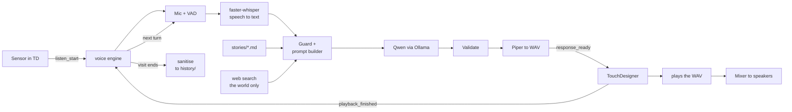
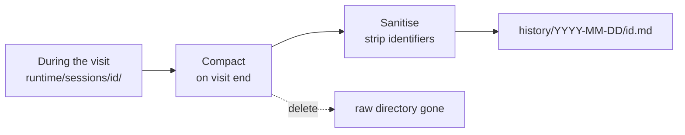

# theoracle

An interactive voice installation. A visitor approaches, a sensor notices, they speak into a
microphone, and the piece tells them a short story drawn from its own written world — in their
own language, out loud, through speakers around the room.

The language model, the speech recognition and the voice all run locally on one Windows laptop.
The only thing that leaves the machine is web search, which is optional and off until you give it
an API key.

---

## Table of contents

- [How it works](#how-it-works)
- [What you need](#what-you-need)
- [Setup](#setup)
  - [Step 1 — Install the tools](#step-1--install-the-tools)
  - [Step 2 — Install Ollama and the language model](#step-2--install-ollama-and-the-language-model)
  - [Step 3 — Set up web search](#step-3--set-up-web-search)
  - [Step 4 — Get TouchDesigner's Python details](#step-4--get-touchdesigners-python-details)
  - [Step 5 — Create the repository](#step-5--create-the-repository)
  - [Step 6 — Create pyproject.toml](#step-6--create-pyprojecttoml)
  - [Step 7 — Create the Python environment](#step-7--create-the-python-environment)
  - [Step 8 — Install faster-whisper and the CUDA libraries](#step-8--install-faster-whisper-and-the-cuda-libraries)
  - [Step 9 — Download the Piper voices](#step-9--download-the-piper-voices)
  - [Step 10 — Write config.yaml](#step-10--write-configyaml)
  - [Step 11 — Link the environment into TouchDesigner](#step-11--link-the-environment-into-touchdesigner)
  - [Step 12 — Run it](#step-12--run-it)
- [Audio hardware](#audio-hardware)
- [How a visit is stored](#how-a-visit-is-stored)
- [Configuration reference](#configuration-reference)
- [Troubleshooting](#troubleshooting)
- [Repository layout](#repository-layout)

---

## How it works

A short spoken conversation, running as two programs that talk over a local socket.



1. **Trigger.** An ultrasonic sensor on an Arduino reports distance over serial to TouchDesigner.
   When someone steps close, TouchDesigner tells the voice engine to start listening.
2. **Listen.** The engine records from the microphone and decides on its own when the visitor has
   finished speaking, using voice activity detection rather than a fixed timer.
3. **Understand.** `faster-whisper` transcribes the audio and detects which language it was in.
4. **Respond.** The transcript, the conversation so far, the story material in `stories/`, and
   optionally some facts about the world go to a local Qwen model running in Ollama. It returns
   the Oracle's reply as structured JSON.
5. **Speak.** Piper synthesises the reply to a WAV file. TouchDesigner plays that file through the
   mixer and drives the visuals from the real audio signal.
6. **Continue, then close.** The loop repeats for four or five exchanges. When the visit ends, the
   session is compacted, stripped of anything identifying, and written to `history/`. The raw
   session directory is deleted.

### The visit

The Oracle is a fortune teller. A visitor usually opens with something random or testing; the
Oracle answers obliquely, asks their first name, asks one thing about them, and then tells them
their life — what they did with it, who was with them, and how it ended, far in the future.

`stories/instructions.md` and `stories/world.md` hold all of this. They are the artistic heart of
the piece and the files you will edit most.

### Three rules the code enforces

These are properties of the program, not requests to the model. The model cannot violate them
even if a visitor talks it into wanting to.

- **The visitor's words are data, never instructions.** Everything in `engine/guard.py` exists to
  keep that true. What a visitor says never becomes part of the system prompt — it arrives as a
  quoted field inside a user message, on every turn, including turns already spoken.
- **Sessions are sealed from each other.** Each visit writes to its own directory, and the prompt
  builder can only read the current one. No visitor's words can reach another's conversation,
  because there is no code path that would carry them. Asking nicely does not help.
- **The model has no file access, no tools and no memory.** It receives strings and returns a
  string. It cannot read `history/`, cannot search on its own, and remembers nothing once a visit
  ends.

### What the web search is for

Ollama's web search gives the Oracle knowledge of the present — today's weather, the tide, the
date, news from the city, something about a trade the visitor mentioned. Spoken flatly next to an
invented future, real present-day detail is what makes the piece feel like it sees clearly.

**It never searches for a person.** Not the visitor, not anyone they name. `engine/websearch.py`
builds queries from a fixed allowlist of impersonal topics; the visitor's words cannot become a
query. This is a hard rule in the code, and [Step 3](#step-3--set-up-web-search) explains why it
is worth keeping.

### The two programs

| Program | What it does | How it is started |
| --- | --- | --- |
| **The voice engine** (this repo, Python) | Microphone, speech recognition, story generation, speech synthesis | `run.bat` |
| **TouchDesigner** | Sensor, visuals, audio playback, mixer output | Open `td/theoracle.toe` |

They communicate over a WebSocket on `127.0.0.1:8765`. TouchDesigner never waits on the engine, so
a slow model can never drop the frame rate.

**Ollama** is a third piece: a background server that holds the language model. It is not a Python
library you import — it is a separate program that listens on `localhost:11434`, and the engine
sends it HTTP requests. Step 2 installs it.

---

## What you need

### Hardware

| Item | Requirement | Notes |
| --- | --- | --- |
| Laptop | Windows, NVIDIA GPU with 8 GB VRAM, 16 GB RAM | The GPU is shared between speech recognition, the language model and TouchDesigner |
| Microphone | Any, on a stand | Visitors are encouraged to speak closely into it |
| Mixer | Allen & Heath CQ-12T | See [Audio hardware](#audio-hardware) |
| Audio dongle | Any cheap class-compliant USB input | Carries the mic feed from the mixer to the engine |
| USB DAC | Any cheap stereo USB output | Carries the voice from the engine to the mixer |
| Sensor | HC-SR04 ultrasonic + Arduino | Sends distance over serial |
| Speakers | 4 powered monitors + 1 centre | Fed from the mixer |

### Software

Installed during setup: Git, uv, Ollama, and the Python packages. You need TouchDesigner
already installed — the Python environment is built on top of the interpreter that ships with it.

You also need an **Ollama account API key** for web search. Create one at ollama.com; there is a
free tier. Web search is the only part of this project that uses the internet at run time.

### Time

About two hours for a first-time setup, most of it downloads.

---

## Setup

> **Before you start:** the repository lives at `C:\theoracle` — directly off the C: drive, not in
> Documents or OneDrive. This matters. Paths with spaces break the environment tooling, OneDrive
> will try to sync a 2 GB model cache and the audio files generated during a show, and deeply
> nested paths hit Windows path-length limits inside the Python packages.

Two shells are used below, and it matters which one:

- **PowerShell** — Windows' own shell. Open it from the Start menu.
- **Git Bash** — installed in step 1. Open it with
  `"C:\Program Files\Git\bin\bash.exe" --login -i` from a Command Prompt, or from the Start menu
  once Git is installed. In Git Bash, `C:\theoracle` is written `/c/theoracle`.

Each step below says which shell to use.

---

### Step 1 — Install the tools

**PowerShell**, anywhere:

```powershell
powershell -ExecutionPolicy ByPass -c "irm https://astral.sh/uv/install.ps1 | iex"
winget install Git.Git
```

`uv` manages Python packages. `Git` provides version control and the Git Bash shell.

Now check your graphics driver:

```powershell
nvidia-smi
```

You should see a table with your GPU name and, in the top right, a CUDA version. **It must be 12
or higher.** If it is lower, or the command is not found, update your NVIDIA driver from
nvidia.com before continuing — nothing later in this guide will work otherwise.

Close and reopen PowerShell so the newly installed tools are on your PATH, then confirm:

```powershell
uv --version
git --version
```

---

### Step 2 — Install Ollama and the language model

Ollama is the program that runs the language model on your GPU. If you have never used it, the
mental model is: it is a **background server**, like a database. You install it once, it starts
with Windows, and programs talk to it over HTTP on port 11434.

#### 2a. Install Ollama

1. Go to **https://ollama.com/download** and download the Windows installer.
2. Run it. It installs to your user folder and starts automatically — no options to choose.
3. Look for the llama icon in your system tray (bottom-right, possibly under the `^` arrow).
   That means the server is running.

Confirm it in **PowerShell**:

```powershell
ollama --version
```

If the command is not found, close and reopen PowerShell. If it still is not found, restart the
machine — the installer adds Ollama to your PATH and that sometimes needs a new session.

#### 2b. Download the model

```powershell
ollama pull qwen3:4b
```

This downloads about 2.5 GB. `qwen3:4b` is a 4-billion-parameter multilingual model — chosen
because it fits alongside speech recognition and TouchDesigner in 8 GB of VRAM. Bigger models
exist but will not fit; see the architecture document if you want the reasoning.

Confirm it arrived:

```powershell
ollama list
```

You should see `qwen3:4b` with its size and a recent timestamp.

#### 2c. Test it

```powershell
ollama run qwen3:4b "Kerro yhden lauseen tarina merestä."
```

The first run takes 10–20 seconds while the model loads into the GPU; after that it is fast. You
should get a sentence of Finnish back. Type `/bye` to exit the chat.

**Read the Finnish carefully.** If it sounds translated rather than written, you have learned
something useful about what the piece will sound like, and it is better to know now.

#### 2d. Check the API endpoint

This is the part that actually matters for the engine. Ollama exposes an OpenAI-compatible API,
and that is what this project talks to:

```powershell
curl http://localhost:11434/v1/models
```

You should get JSON listing `qwen3:4b`. If you get a connection error, Ollama is not running —
check the tray icon, or start it from the Start menu.

#### 2e. Keep the model loaded

By default Ollama unloads a model after five minutes of inactivity. In a gallery that means the
first visitor after a quiet spell waits 15 seconds. Fix it with an environment variable:

1. Press `Win`, type **Environment Variables**, open *Edit the system environment variables*.
2. Click **Environment Variables…**
3. Under *User variables*, click **New…**
4. Name: `OLLAMA_KEEP_ALIVE` — Value: `-1`
5. OK through all dialogs.
6. **Restart Ollama** — right-click the tray icon, Quit, then start it again from the Start menu.

This must be set for the Ollama *server*, not for the engine. Setting it in `run.bat` does
nothing, because it is read by Ollama when it starts.

#### How the engine connects to it

You do not need to do anything else here — this is just so you understand what `config.yaml`
means later. The engine uses the standard `openai` Python library, pointed at Ollama instead of
OpenAI:

```python
client = OpenAI(base_url="http://localhost:11434/v1", api_key="ollama")
```

The `api_key` is ignored by Ollama but the library requires a value. That single line is the whole
integration — which is also why switching to a cloud model later would be a one-line change.

---

### Step 3 — Set up web search

This part is different from everything else in this guide: **it is a cloud service.** The model
runs on your laptop, but web search does not. Queries go to Ollama's servers over the internet
and need an account API key.

That is a reasonable trade for what it gives the piece, but it means "fully offline" stops being
true once this is on. Decide it deliberately, and if the installation has signage, it belongs
there.

#### 3a. Install the packages

**Git Bash**, in `/c/theoracle` — or PowerShell if you have not created the project yet; you can
also fold these into step 6 and run them with `uv pip install`:

```bash
python -m pip install --upgrade "ollama>=0.6.0" python-dotenv
```

#### 3b. Store your API key

Your key goes in a `.env` file, which is **never committed to git** — `.gitignore` already
excludes it.

```bash
cd /c/theoracle
cat > .env <<'EOF'
OLLAMA_API_KEY=your-key-here
EOF
```

Replace `your-key-here` with your actual key. If you do not have one, create it in your account
settings at https://ollama.com.

Also create `.env.example`, which **is** committed, so whoever sets this up next knows what is
needed without you having to send them a key:

```bash
cat > .env.example <<'EOF'
# Copy to .env and fill in. Never commit .env.
OLLAMA_API_KEY=
EOF
```

#### 3c. Test it

Create `scripts/ollamaweb.py`:

```python
from dotenv import load_dotenv

# This must happen before importing ollama
load_dotenv()

import ollama

response = ollama.web_search("What is Ollama?")

for result in response.results:
    print(result.title)
    print(result.url)
    print(result.content)
    print()
```

Run it:

```bash
python scripts/ollamaweb.py
```

You should get a handful of titles, URLs and text. If you get an authentication error, check the
key in `.env` — and check that `load_dotenv()` really does run before `import ollama`, because
the library reads the key at import time. That ordering is the single most common mistake here,
and the comment in the file above is worth keeping.

#### 3d. What the Oracle is allowed to search for

**The engine never searches for a person.** Not the visitor, not anyone they mention.
`engine/websearch.py` builds every query from a fixed allowlist — weather, tide, date, season,
the city, a trade or craft, a place, general news. A visitor's words are matched against that
allowlist to *choose* a topic; they are never passed through into a query.

This is worth being clear about, because the obvious version of this feature is to search the
name the visitor just gave you, and it does not survive contact with a public space:

- Most searches on a common Finnish name return **a different person entirely**, and the piece
  then narrates a stranger's life back at someone with total confidence.
- When it *is* them, the piece has just read a private individual's employer, address, family
  news or court record aloud to a room of strangers.
- Someone will eventually give it an ex-partner's or a colleague's name, at which point the
  installation is a doxxing tool with a PA system attached.
- The piece then predicts how that named real person dies.

The artistic effect you want survives this constraint completely. Oracles do not feel uncanny
because they researched you — they feel uncanny because they know the present moment and reflect
your own words back. Being *named* by the Oracle is the intimate part, and the name costs nothing
to use for address alone.

If you decide otherwise, the allowlist in `engine/websearch.py` is the one place to change, and
the consequences above are yours to weigh.

---

### Step 4 — Get TouchDesigner's Python details

The Python environment for this project is built **on top of TouchDesigner's own Python
interpreter**, so the two stay compatible. To do that you need three values from it.

Open TouchDesigner. Open the textport (`Alt+T`, or *Dialogs → Textport and DATs*). Paste:

```python
import sys, numpy
print(sys.executable)
print(sys.version)
print(numpy.__version__)
```

You will get something like:

```
C:/Program Files/Derivative/TouchDesigner/bin/python.exe
3.11.1 (main, ...)
1.24.4
```

**Write all three down.** They are used in steps 6 and 7, and guessing here is the single most
common way this setup goes wrong.

---

### Step 5 — Create the repository

**Git Bash:**

```bash
mkdir -p /c/theoracle
cd /c/theoracle
git init

mkdir -p engine stories voices scripts td/scripts
mkdir -p runtime/sessions logs history
touch engine/__init__.py
```

That creates every folder the project needs in one go.

| Folder | Holds | In git? |
| --- | --- | --- |
| `engine/` | The Python code | yes |
| `stories/` | The Oracle's instructions and world | yes |
| `voices/` | Piper speech synthesis voices | yes |
| `scripts/` | Helper scripts and diagnostics | yes |
| `td/` | The TouchDesigner project | yes |
| `history/` | Sanitised visit summaries, no names | your call |
| `runtime/sessions/` | One directory per live visit, deleted when it ends | no |
| `logs/` | Engine logs | no |

Now create `.gitignore`, before the first commit:

```bash
cat > .gitignore <<'EOF'
.venv/
__pycache__/
*.pyc
runtime/
logs/
config.local.yaml
td/*.toe.[0-9]*

# Secrets - the API key lives here and must never be committed
.env
EOF
```

The last line ignores TouchDesigner's automatic backup files, which otherwise accumulate in every
commit.

Create the shell helper, so you do not have to retype the environment variables every time you
open a new terminal:

```bash
cat > scripts/setup-shell.sh <<'EOF'
export UV_PYTHON="/c/Program Files/Derivative/TouchDesigner/bin/python.exe"
export UV_PYTHON_DOWNLOADS=never
EOF
```

**Edit that path** if step 3 printed something different. Note the format: forward slashes, and
`/c/` instead of `C:\`. That is Git Bash's way of writing Windows paths.

---

### Step 6 — Create pyproject.toml

Create `C:\theoracle\pyproject.toml` in any text editor:

```toml
[project]
name = "theoracle"
version = "0.1.0"
requires-python = "==3.11.*"
dependencies = [
  "piper-tts>=1.3",
  "ollama>=0.6",
  "openai>=1.40",
  "sounddevice>=0.4.6",
  "websockets>=12",
  "python-osc>=1.8",
  "pyyaml>=6",
  "rank-bm25>=0.2.2",
  "numpy==1.24.4",
]

[tool.uv]
python-downloads = "never"
```

**Two values must match step 4:**

- `requires-python` — if TouchDesigner printed `3.12.x`, write `"==3.12.*"`.
- `numpy` — set it to exactly the version TouchDesigner printed. If the versions differ,
  TouchDesigner can break in confusing ways once the environment is linked in step 10.

---

### Step 7 — Create the Python environment

**Git Bash**, in `/c/theoracle`:

```bash
source scripts/setup-shell.sh
echo $UV_PYTHON
```

That should print TouchDesigner's Python path. If it prints nothing, the helper script was not
found — check you are in `/c/theoracle`.

```bash
uv venv
source .venv/Scripts/activate
uv sync
```

Now the **most important check in this guide**:

```bash
python -c "import sys; print(sys.version)"
```

**This must print the same version TouchDesigner printed in step 4.**

If it does not, uv built the environment on a different Python — usually because the path in
`setup-shell.sh` is wrong. Fix it and start the step over:

```bash
rm -rf .venv
# correct the path in scripts/setup-shell.sh, then repeat from the top of step 7
```

Do not continue past a mismatch. Everything will appear to work in the terminal and fail inside
TouchDesigner, which is a miserable thing to debug later.

> **Every new terminal:** you must run `source scripts/setup-shell.sh` and
> `source .venv/Scripts/activate` again. They do not persist between sessions.

---

### Step 8 — Install faster-whisper and the CUDA libraries

Speech recognition needs NVIDIA's CUDA libraries, which are not bundled. **Git Bash**, in
`/c/theoracle`, environment active:

```bash
uv pip install faster-whisper
uv pip install nvidia-cublas-cu12 nvidia-cudnn-cu12
```

Test it on its own before going further — this is the step that most often fails:

```bash
python -c "from faster_whisper import WhisperModel; WhisperModel('large-v3-turbo', device='cuda', compute_type='int8'); print('loaded ok')"
```

The first run downloads about 1.6 GB. **Do this on your own network, not the gallery's.**

If you see `loaded ok`, speech recognition is working on the GPU. If you see an error mentioning
`cudnn64_9.dll` or `cublas64_12.dll`, see [Troubleshooting](#troubleshooting).

Record what you just installed, because these two commands are invisible to `uv sync` and will not
be reproduced on another machine:

```bash
cat > scripts/requirements-gpu.txt <<'EOF'
# Installed with `uv pip`, not `uv add`, because faster-whisper needs the
# NVIDIA CUDA 12 / cuDNN 9 libraries which are not managed in pyproject.toml.
# Run these after `uv sync` on a new machine:
faster-whisper
nvidia-cublas-cu12
nvidia-cudnn-cu12
EOF
```

---

### Step 9 — Download the Piper voices

Piper turns text into speech. Each voice is two files: a model and its configuration.

**Git Bash**, in `/c/theoracle`, environment active:

```bash
uv pip install piper-tts
python -m piper.download_voices fi_FI-harri-medium --data-dir voices
python -m piper.download_voices sv_SE-nst-medium  --data-dir voices
python -m piper.download_voices en_GB-alba-medium --data-dir voices
ls -la voices/
```

You should see three `.onnx` files and three `.onnx.json` files. If the `--data-dir` flag is not
recognised, check `python -m piper.download_voices --help` — the files must end up in
`C:\theoracle\voices`, not wherever you happened to be.

**Listen to each one before moving on.** Voice quality varies a lot between languages, and the
Finnish voice in particular is worth auditioning with your real story text. It is better to be
disappointed now than after everything is built.

To add more languages later, the full list is at
https://huggingface.co/rhasspy/piper-voices — roughly 48 languages have voices. Add the new voice
to the `tts.voices` map in `config.yaml`.

---

### Step 10 — Write config.yaml

Create `C:\theoracle\config.yaml`:

```yaml
audio:
  input_device: "USB Audio CODEC"    # the dongle carrying the mic feed
  output_device: "USB Audio DAC"     # the DAC feeding the mixer
  silence_ms: 800                    # silence before the engine stops listening
  max_utterance_s: 20
  speech_start_timeout_s: 8
  min_speech_s: 0.5
  preroll_s: 2.0                     # audio kept from before the trigger

stt:
  model: large-v3-turbo
  device: cuda
  compute_type: int8
  min_confidence: 0.5
  allowed_languages: [fi, sv, en]
  default_language: fi

llm:
  base_url: http://localhost:11434/v1
  model: qwen3:4b
  think: false
  num_predict: 150
  temperature: 0.8
  timeout_s: 15
  max_retries: 1

websearch:
  enabled: true
  timeout_s: 3                       # hard cap; a slow search is skipped, never waited on
  max_chars: 2000                    # results truncated before they reach the model
  max_per_visit: 2
  cache_minutes: 30                  # identical topics reuse a result
  allowed_topics:                    # THE ONLY THINGS THAT CAN BE SEARCHED
    - weather
    - tide
    - date
    - season
    - city
    - trade
    - place
    - news
  # Visitor speech is matched against this list to CHOOSE a topic.
  # It is never passed into a query. Never add "name" or "person" here.

conversation:
  max_turns: 8                       # hard cap; the visit ends after this
  max_silence_s: 12                  # no reply -> the visit ends
  end_on_sensor_clear_s: 5           # they walked away
  context_turns: 6                   # how much of the visit the model sees

tts:
  voices:
    fi: fi_FI-harri-medium
    sv: sv_SE-nst-medium
    en: en_GB-alba-medium
  length_scale: 1.0
  output_dir: runtime/audio
  max_duration_s: 45
  keep_last: 20

guard:
  max_input_chars: 300
  max_output_chars: 600
  cooldown_s: 2.0
  max_per_minute: 12

bridge:
  ws_host: 127.0.0.1
  ws_port: 8765
  ws_token: "change-me"
  osc_td_port: 9001

logging:
  store_transcripts: true            # raw, in the session dir, deleted at visit end
  history_dir: history               # sanitised summaries, kept
  sanitize_on_end: true              # MUST stay true in an exhibition
  keep_raw_sessions: false           # true only while debugging, never in a show
```

**Audio device names.** The two device names must match what Windows calls your hardware. They are
matched by substring, so a distinctive fragment is enough. Run `scripts/check_env.py` (step 12) to
print every device on your system, then paste the right fragments in.

Do not use the Windows default device. It changes silently the first time anything is plugged in.

**About `websearch`.** `allowed_topics` is the whole security model for this feature, not a
convenience list. The engine picks a topic from it and builds the query itself; nothing a visitor
says is ever interpolated into a search. Adding a topic that could resolve to a person undoes
that — see [Step 3](#step-3--set-up-web-search).

The API key is read from `.env`, never from this file. Keep it that way; `config.yaml` is
committed and `.env` is not.

**About `logging`.** `store_transcripts: true` keeps the raw conversation for the length of the
visit only, in that visit's own directory. When the visit ends, `sanitize_on_end` strips the
identifying material and writes a summary to `history/`, then deletes the raw directory. Leaving
`sanitize_on_end` false, or `keep_raw_sessions` true, means names and unedited speech accumulate
on the disk of a machine standing in a public room. Both exist for debugging; neither belongs in
an exhibition.

---

### Step 11 — Link the environment into TouchDesigner

TouchDesigner needs to know where the environment is, so it can import from it.

1. Open TouchDesigner and save the project as `C:\theoracle\td\theoracle.toe`.
2. Open the **Palette** (`Alt+L`).
3. Find **tdPyEnvManager** under *Tools*.
4. Drag it into your project.
5. Set its **Install Path** parameter to `C:\theoracle\.venv`.
6. Set **Environment Name** to `theoracle`.
7. Activate it.

Test it from the textport:

```python
import yaml
print(yaml.__file__)
```

The path printed should be inside `C:\theoracle\.venv`. If it is, the link works.

> **Keep heavy libraries out of TouchDesigner.** Do not `import faster_whisper`, `ctranslate2` or
> `onnxruntime` from inside TouchDesigner. They load CUDA into TouchDesigner's own process, which
> on an 8 GB card causes memory problems, and a crash in either one would take down both. The
> engine runs as a separate program for exactly this reason. TouchDesigner only needs light
> imports.

---

### Step 12 — Run it

Create `C:\theoracle\run.bat`:

```bat
@echo off
cd /d "%~dp0"
set HF_HUB_OFFLINE=1
.venv\Scripts\python.exe -m engine
```

`HF_HUB_OFFLINE=1` stops the engine trying to reach the internet at startup. Once the models are
downloaded it does not need to, and without this a startup with no network hangs for a minute
while it times out — which on an opening morning looks exactly like a crash.

Before the first real run, check everything:

```bash
python scripts/check_env.py
```

This reports Python version, GPU and free VRAM, whether Whisper loads, whether Ollama answers,
whether the voices are present, and every audio device by name. Run it whenever something behaves
oddly — it usually tells you which step to go back to.

Then:

1. Double-click `run.bat`. The engine starts and waits.
2. Open `td/theoracle.toe`.
3. Trigger the sensor, or the test button in the TouchDesigner patch.

Finally, make your first commit:

```bash
cd /c/theoracle
git add -A
git status          # confirm .venv, runtime/ and logs/ are NOT listed
git commit -m "theoracle: project skeleton, environment, voices"
```

Committing here — before any engine code — gives you a clean snapshot of a working environment. If
something breaks in three weeks, you can tell whether the environment changed or your code did.

---

## Audio hardware

Summarised; the reasoning is in the architecture document.

Only one program can own the mixer's USB interface on Windows, so it goes to **VCV Rack**, which
is the only one needing separate outputs per speaker. The other two reach the mixer as ordinary
audio.

```
Microphone ──> CQ ch1 (high-pass, gate, compressor)
                 └──> TRS Out 6 (mic only) ──> USB dongle ──> engine

VCV Rack ──USB/ASIO──> CQ USB returns 1-4 ──> monitor mixes 1-4

Engine ──> USB DAC ──> CQ stereo input ──> all five mixes

CQ Out 1-4 ──> four monitors around the room
CQ Out 5   ──> centre speaker at the screen
```

Three things to know:

- **The mic goes through the mixer first, deliberately.** The gate and compressor on the channel
  strip do more for speech recognition accuracy than any software setting. Set the gate with the
  monitors at show level, not in a silent room.
- **Out 6 carries only the microphone.** Neither the voice nor the generative audio is in it, so
  the installation physically cannot transcribe itself.
- **Do not use the HDMI screen's speakers.** Its audio comes from the graphics card, not the
  mixer, and would arrive 40–150 ms later than everything else — an audible echo. Mute it and use
  the centre speaker on Out 5.

---

## Configuration reference

The settings most worth adjusting once it is running:

| Setting | Default | Effect |
| --- | --- | --- |
| `audio.silence_ms` | 800 | How long a visitor can pause before the engine stops listening. Lower feels snappier; too low cuts people off mid-thought |
| `audio.preroll_s` | 2.0 | Audio kept from before the trigger, so the first word is not lost |
| `stt.min_confidence` | 0.5 | Below this, the detected language is not trusted and the default is used |
| `stt.allowed_languages` | fi, sv, en | Only languages you have a voice for. The engine picks the best-scoring one from this list |
| `llm.num_predict` | 150 | Roughly 45 seconds of speech. Lowering it shortens both the story and the wait |
| `llm.temperature` | 0.8 | How much stories vary between visitors |
| `guard.max_per_minute` | 12 | Stops one person monopolising the piece |
| `conversation.max_turns` | 8 | Hard cap on a visit. Also the backstop against someone working at the model over many turns |
| `conversation.context_turns` | 6 | How much of the visit the model sees. Lower is safer and cheaper; too low and it forgets their name |
| `websearch.max_per_visit` | 2 | Searches per visit. One is usually enough — two details sound like a weather report |
| `tts.length_scale` | 1.0 | Speech speed. Above 1.0 is slower |

Expect about **4–6 seconds** between a visitor finishing speaking and the first word of the reply,
most of it the language model. This is normal and by design — the wait is covered by the visuals,
which track the engine's state throughout.

---

## Troubleshooting

| Symptom | Cause | Fix |
| --- | --- | --- |
| `python -c "import sys..."` prints a different version than TouchDesigner | uv built the environment on the wrong Python | `rm -rf .venv`, correct the path in `scripts/setup-shell.sh`, redo step 7 |
| `Could not locate cudnn64_9.dll` | CUDA libraries not on PATH | Re-run `uv pip install nvidia-cublas-cu12 nvidia-cudnn-cu12`. If it persists, download Purfview's `whisper-standalone-win` library archive and add its folder to PATH |
| `Could not locate cublas64_12.dll` | Same | Same |
| An error mentioning cuDNN 8 | Version mismatch | `uv pip install --force-reinstall ctranslate2==4.4.0` |
| `ollama: command not found` | PATH not refreshed | Reopen PowerShell; if it persists, restart Windows |
| Connection refused on port 11434 | Ollama server not running | Check the system tray, or start Ollama from the Start menu |
| First visitor after a quiet spell waits 15 s | Model unloaded | Set `OLLAMA_KEEP_ALIVE=-1` and restart Ollama (step 2e) |
| TouchDesigner behaves strangely after linking the environment | NumPy version conflict | Make the `numpy` pin in `pyproject.toml` match what TouchDesigner reports, then `uv sync` |
| Engine hangs for a minute at startup | Trying to reach Hugging Face with no network | Confirm `HF_HUB_OFFLINE=1` is in `run.bat` |
| Engine cannot find the microphone | Device name does not match | Run `scripts/check_env.py`, copy the exact device name fragment into `config.yaml` |
| Finnish transcribed as Estonian | Short utterance, uncertain detection | Normal. `min_confidence` catches it; add `et` and a voice for it if Estonian speakers are common |
| Whisper transcribes "Kiitos" from silence | Hallucination on near-empty audio | Set the mixer's gate properly — this is a hardware fix, not a software one |
| VCV Rack clicks when someone speaks | CPU contention | Should not happen with Whisper on the GPU. If you moved it to CPU, cap `cpu_threads` and raise VCV's ASIO buffer |
| Web search returns an auth error | Key missing or loaded too late | Check `.env`, and check `load_dotenv()` runs **before** `import ollama` — the library reads the key at import time |
| Web search works in `ollamaweb.py` but not in the engine | Import order again | Same cause. `load_dotenv()` must be the first thing `engine/__main__.py` does |
| Visits never end | Sensor stuck, or silence timeout too long | Check `conversation.max_silence_s` and `end_on_sensor_clear_s`. `max_turns` is the backstop |
| `history/` entries contain a name | Sanitisation failed or was disabled | Confirm `sanitize_on_end: true`. Delete the affected files, then check the name list covers that language |
| `runtime/sessions/` is filling up | Sessions not being closed | Directories should be deleted at visit end. Check `keep_raw_sessions` is `false` |
| The Oracle explains that it cannot do something | It refused in the wrong voice | Tighten the refusal examples in `stories/instructions.md` — a filter-sounding refusal breaks the piece more than the attempt did |

---

## Repository layout

```
C:\theoracle\
  README.md                  this file
  config.yaml                every tunable setting          (in git)
  .env                       OLLAMA_API_KEY                 (NEVER in git)
  .env.example               the shape of .env, no secrets  (in git)
  pyproject.toml             dependencies, Python pinned to TouchDesigner's
  run.bat                    starts the engine
  .gitignore

  engine/
    __main__.py              state machine, the visit loop
    audio_in.py              recording, voice activity detection
    stt.py                   speech to text
    guard.py                 input screening, output validation
    llm.py                   Ollama client, JSON schema
    websearch.py             topic allowlist, query builder, sanitiser
    corpus.py                loads the story material
    session.py               per-visit state, compaction, sanitisation
    tts.py                   speech synthesis, WAV output
    bridge.py                WebSocket and OSC
    prompts.py               prompt assembly per turn
    schema.py                the response format

  stories/
    instructions.md          who the Oracle is, how it speaks, what it refuses
    world.md                 the setting, and how futures are built
    stories.md               fragments and reference material

  voices/                    Piper voice files
  scripts/
    setup-shell.sh           environment variables for a new terminal
    check_env.py             diagnostics
    ollamaweb.py             web search smoke test
    requirements-gpu.txt     what was installed outside pyproject.toml
  td/
    theoracle.toe            the TouchDesigner project
    scripts/ws_callbacks.py

  history/                   sanitised visit summaries      (in git or not - your call)
  runtime/
    sessions/<id>/           one live visit                 (not in git, deleted at end)
      transcript.jsonl
      responses/             raw web search results
      audio/                 generated WAVs
  logs/                      engine logs                    (not in git)
  .venv/                     the Python environment         (not in git)
```

### The story material

`stories/` is where the piece actually comes from. The files are loaded at startup and placed in
the model's system prompt — the trusted part, kept strictly separate from anything a visitor says.

- `instructions.md` — who the Oracle is, how it speaks, the shape of a visit, and everything it
  refuses to do.
- `world.md` — the setting, its images, and the rules for building somebody's future.
- `stories.md` — fragments and reference material to draw from.

Keep the total under roughly 4,000 tokens and it all fits in the prompt with room to spare. Beyond
that the engine selects the most relevant fragments per visit instead.

These two files are where you will do the actual artistic work. Almost everything about how the
piece feels is in there, not in the Python.

---

## How a visit is stored

Raw material exists only while a visitor is standing there. Three stages:



**1. During the visit** — `runtime/sessions/<id>/` holds the transcript, the raw web search
results in `responses/`, and the generated audio. It is the only thing the prompt builder can
read, which is what keeps visits sealed from each other.

**2. On visit end** — the conversation is compacted into a short summary, and the web search
results are cleaned into the paragraph of prose that was actually used.

**3. Sanitise and move** — identifying material is stripped and the result is written to
`history/`. The raw directory is deleted.

### What is removed

| Removed | How |
| --- | --- |
| The name they gave | The engine asked for it, so it knows the exact string to redact — the most reliable redaction in the system |
| Any other names | Pattern match plus a name list for the exhibition's languages |
| Numbers that could identify | Phone numbers, addresses, dates of birth, ID-shaped strings |
| Emails and URLs | Pattern match |
| The audio | Deleted with the session directory — voices are biometric data and there is no reason to keep them |

### What is kept

```markdown
# Visit 2026-09-20T18:42

- language: fi
- turns: 5
- duration: 2m 10s
- archetype: a young person asking about work
- topics: employment, a move, a sibling
- mood arc: mysterious -> tense -> hopeful
- web topic used: weather
- refusals: 0

## Summary
Came in testing the piece, gave a name, asked whether to take a job in another
city. Was given a life of eleven years in work they did not respect, a late
friendship, and a death at ninety-one by water.
```

Enough to understand who the piece is meeting and how it is behaving; nothing that identifies
anyone. That is what makes `history/` safe to keep, and interesting — a record of the piece's life
rather than its visitors'.

### A note on Finnish law

Once names are spoken into a microphone and written to disk, even briefly, that is personal data
under GDPR. The design above is defensible because retention is minutes, sanitisation is
automatic, and nothing identifying survives. Two things keep it that way:

- **Never set `sanitize_on_end: false` or `keep_raw_sessions: true` during an exhibition.** They
  exist for debugging on your own machine.
- **Put up a sign.** Something short: that the piece listens, that it forgets, that a summary with
  no names is kept. Visitors mostly find this reassuring rather than off-putting, and it is a
  better answer than being asked about it later.

Web search adds one more line to that sign, because it is the one thing leaving the laptop. What
leaves is a query the engine wrote about the weather or the city — never anything a visitor said.
